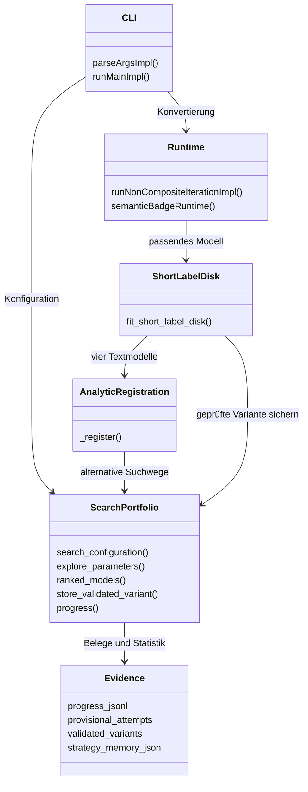
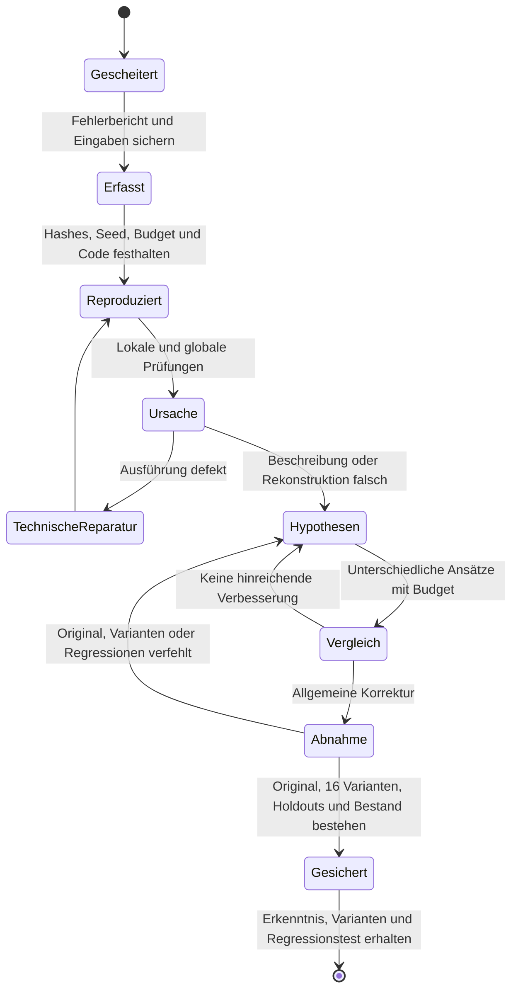

# Bildkonvertierung und Lernschleife als UML

Stand: 2026-10-18. Die Diagramme skizzieren Verantwortlichkeiten und Abläufe;
sie behaupten keine automatische Unterstützung beliebiger Bildtopologien.
Die Mermaid-Blöcke sind direkt renderbare Sequenz-, Klassen- und Zustandsdiagramme.
Die Modellschleife zeigt Alternativen innerhalb angeschlossener Registrierungen.
Der Runtime-Dispatcher beendet einige Spezialpfade weiterhin früh; ein gemeinsamer
Vergleich aller unterstützten Formfamilien ist noch nicht umgesetzt.

Die drei Parametersuchwege sind ein Teilbaustein. Die
[adaptive Steuerung](adaptive_conversion_search_2026-10-18.md) führt sie nun in
kurzen Abschnitten aus: früher geprüfter Erfolg, Stagnation und später
Fortschritt steuern Ende und begrenzte Verlängerungen. Eine durchgängige harte
Unterbrechung und erweiterbare Struktursuche bleiben offen. `mermaid-diagram.png`
im Projektstamm zeigt den älteren festen Ablauf dieses Sequenzdiagramms.

## Konvertierung und alternative Suche: Sequenzdiagramm

```mermaid
sequenceDiagram
    actor User as Nutzer
    participant CLI
    participant Runtime
    participant Model as Beschreibungs- und Rastermodelle
    participant Search as Suchportfolio
    participant Renderer
    participant Gate as Lokale Prüfung
    participant Store as Sucharchiv
    User->>CLI: Raster + Beschreibung + Budget + optionaler Seed
    CLI->>Runtime: Konvertierung mit Suchkonfiguration
    Runtime->>Model: Passende Modelle aus Beschreibung und Raster bilden
    loop Unterstützte Modellhypothesen
        Model->>Search: Analytischer Start und bisherige Registrierung
        opt Restfehler und Portfolio aktiviert
            loop Adaptive Abschnitte der Parametersuchwege bis Erfolg, Stagnation oder Budgetgrenze
                Search->>Renderer: Neue gültige Parameter rendern
                Renderer-->>Search: Raster
                Search->>Search: Verlust und Fehler prüfen, Dubletten vermeiden
                Search-->>CLI: Fortschritt, Prüfzahl, bester Fehler
                Search->>Store: Auch gescheiterte Versuche sichern
            end
        end
        Search-->>Model: Bester nicht verschlechterter Fit
        Model->>Gate: Kreis, Schriftkontur und zusätzliche Rasteranteile prüfen
        opt Lokale Semantik besteht
            Gate->>Store: Variante + getrenntes Pixelgate speichern
            opt Standardmodus und strenger Pixelpass
                Gate->>Store: Erfolgreiche Modellart zählen
            end
        end
    end
    Runtime-->>CLI: Beste zulässige Ausgabe
    CLI-->>User: SVG und Berichte
    Note over Store,CLI: semantic-only liest keine gespeicherten Vorlagen oder Strategiestatistik
    Note over Search,Runtime: Kooperative Bildzeit: 60 s regulär, bei spätem Fortschritt bis 120 s; allgemeine Struktursuche offen
```

## Verantwortlichkeiten: vereinfachtes Klassendiagramm

Die Kästen repräsentieren überwiegend Python-Module, keine zusätzlich
implementierten objektorientierten Klassen.



`_register` wird auch von weiteren analytischen Formregistrierungen verwendet.
Andere Optimierer und frühe Spezialpfade sind noch nicht vollständig an das
Portfolio angebunden. Die ursprüngliche Pipeline besitzt weiterhin eigene
Parser-, Perception-, Geometry-IR-, Raster- und Qualitätsmodule.

## Fehlernachbearbeitung: Zustandsdiagramm

Dieser Prozess verbindet die vorhandene automatische Fehlererfassung mit der
dokumentierten Entwicklungsarbeit. Ursachenanalyse und Codekorrektur sind noch
keine unbeaufsichtigte Runtime-Funktion.



Vorgehen, Befehle und Grenzen stehen im
[Nachbearbeitungsprozess](plan_b_learning_workflow.md).
