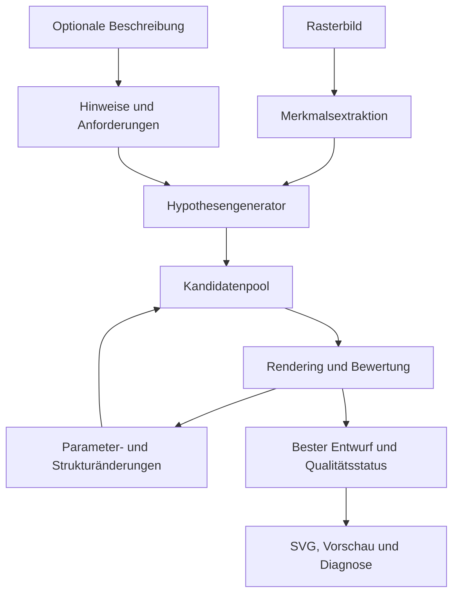

# AP 0 – Architekturanalyse des ImageConverters

**Stand:** 27. November 2026  
**Repository:** [MobyDickDick/ImageConverter](https://github.com/MobyDickDick/ImageConverter)  
**Entwicklungszweig:** [experimental/explorative-conversion](https://github.com/MobyDickDick/ImageConverter/tree/experimental/explorative-conversion)  
**Status:** Erste Bestandsaufnahme dokumentiert; vollständige Abnahme offen.

## 1. Motivation und Zielsetzung

Der ImageConverter soll nicht primär bekannte Lösungen wiedererkennen, sondern selbstständig nach Lösungen suchen. Die Bildbeschreibung soll die Suche unterstützen, nicht blockieren. Ein lesbares Rasterbild soll auch bei fehlender, unvollständiger oder unbekannter Beschreibung zu einer tatsächlichen geometrischen Modellsuche führen.

Ausgangspunkt ist ein reproduzierter Fehler: Bei einem rot gefüllten Kreis mit zwei spiegelbildlich angeordneten Linien konnte eine fehlende Farbangabe in der Beschreibung dazu führen, dass überhaupt keine Konvertierung stattfand. Nach Angabe «weisse Linien» funktionierte die Konvertierung laut Anwender tadellos. Die vorangegangene Diagnose ergab für einen fehlgeschlagenen Lauf `no_result`, `models_exhausted` und `insufficient_description_no_raster_fallback`, bei null Modellbewertungen und null Renderings. Das ist kein Nachweis, dass der mathematische Algorithmus ungeeignet ist; vielmehr wurde er in diesem Lauf nicht genutzt.

Das Ziel ist eine explorative, hypothesengesteuerte Raster-zu-Vektor-Konvertierung mit frei kombinierbaren geometrischen Grundelementen, konkurrierenden Modellen, struktureller Suche und kontinuierlicher Parameteroptimierung. Ein Suchbudget von beispielsweise 300 Sekunden soll bei Bedarf genutzt werden. Früher Erfolg bleibt zulässig.

## 2. Untersuchungsumfang und Evidenz

Die Bestandsaufnahme basiert auf der in der Unterhaltung untersuchten Modulstruktur des experimentellen GitHub-Branches, ausgewählten Quellcodeabschnitten und der vorangegangenen lokalen Fehlerdiagnose mit Tracer und Originalprotokollen. Es handelt sich um eine qualitative statische Analyse, nicht um eine vollständige Prüfung aller Dateien. Die Git-Commit-ID wurde nicht fixiert; die nachfolgenden Branch-Links sind daher veränderlich. Keine Laufzeittests, keine vollständige Abhängigkeitsanalyse und keine Änderungen am Repository wurden im Rahmen von AP 0 vorgenommen.

## 3. Inventar wiederverwendbarer Komponenten

Alle folgenden Modulnamen tragen im Bestand das Präfix `imageCompositeConverter` und liegen unter `src/iCCModules/`.

| Modul                  | Beobachtete Aufgabe                                                                    | Empfehlung                                                    |
| ---------------------- | -------------------------------------------------------------------------------------- | ------------------------------------------------------------- |
| AdaptiveSearch.py      | Suchsession, Zeit- und Rendering-Budget, Cache, Qualitätsmessung, Kandidatentelemetrie | Behalten, Schnittstelle prüfen                                |
| SearchScheduler.py     | Kooperative, faire Verteilung der Suchzeit auf Modelle                                 | Wiederverwenden                                               |
| SearchPortfolio.py     | Suchkonfiguration, Modellreihenfolge, Parameterexploration, Validierung                | Anpassen                                                      |
| SearchBots.py          | Kooperierende Parameteroptimierer                                                      | Wiederverwenden                                               |
| PrimitiveEvolution.py  | Population, Mutation, Kreuzung, lokale Optimierung, Checkpoints                        | Kernverfahren wiederverwenden, Strukturflexibilität erweitern |
| SceneProgram.py        | Grundformen, Relationen, Parameter und SVG-Erzeugung                                   | Von striktem Beschreibungseingang entkoppeln                  |
| StructureSearch.py     | Strukturelle Änderungen rasterbasierter Objektvorschläge                               | Erweitern; feste Inventargrenzen prüfen                       |
| NativeSearch.py        | Suchfrontier für vorhandene SVGs, Vereinfachung und Rekonstruktion                     | Wiederverwenden, Start ohne vorhandenes SVG ergänzen          |
| SceneInitialization.py | Rasterbasierte Startparameter für deklarierte Objekte                                  | Verallgemeinern                                               |
| SceneFusion.py         | Sichtbare Konturen, Teilformen und Szenenkombinationen                                 | Wiederverwenden                                               |
| PrimitiveScene.py      | Anpassung einfacher, getrennter Grundformen                                            | Als Vorschlagsgenerator prüfen                                |
| Representation.py      | Objektinventar, Vereinfachung und Komplexitätsbewertung                                | Behalten, harte Beschreibungsgrenzen differenzieren           |
| FilledSymbols.py       | Gemeinsame Registrierung und Optimierung analytischer Modelle (`_register`)            | Als Adapter nutzbar machen                                    |
| DescriptionLanguage.py | Normalisierung und explizite semantische Assertions                                    | Hinweise, Unsicherheit und harte Anforderungen trennen        |
| Deadline.py            | Prozessüberwachung, IPC, temporäre Ausgaben, Checkpoints                               | Für Produktion erhalten; Debugmodus entkoppeln                |

**Einschätzung:** Die mathematischen Verfahren, Rendering, Parameteroptimierung und Suchverwaltung besitzen ein hohes Wiederverwendungspotenzial. Geometrische Repräsentation und Struktursuche sind teilweise geeignet. Beschreibungserkennung und übergeordnete Ablaufsteuerung müssen besonders kritisch überarbeitet werden. Diese Einstufung ist qualitativ, keine gemessene Kennzahl.

## 4. Konkrete architektonische Blockaden

### 4.1 Strikte Erkennung von Satzmustern

[SymmetricCircleLines.py, Zeilen 14–35](https://github.com/MobyDickDick/ImageConverter/blob/experimental/explorative-conversion/src/iCCModules/imageCompositeConverterSymmetricCircleLines.py#L14-L35) verwendet zwei vollständige reguläre Ausdrücke (`re.fullmatch`). Abweichender Wortlaut oder eine fehlende Linienfarbe kann `None` ergeben. Der nachfolgende Fitter besitzt jedoch bereits Konturerkennung, Kreisapproximation mittels kleinster Quadrate, Linienanpassung, Farbabschätzung, Spiegelung und iterative Optimierung.

Folgerung: Die Modellauswahl ist hier unnötig eng mit dem Wortlaut gekoppelt. Kein weiterer bildspezifischer Regex als strategische Lösung.

### 4.2 Die freie Grundformensuche benötigt ein vollständiges Beschreibungsprogramm

[PrimitiveEvolution.py, Zeilen 93–100](https://github.com/MobyDickDick/ImageConverter/blob/experimental/explorative-conversion/src/iCCModules/imageCompositeConverterPrimitiveEvolution.py#L93-L100):

```
program = scene_program(description)
if program is None:
    raise ValueError('Diese Beschreibung wird von der freien Grundformensuche noch nicht vollständig unterstützt.')
```

Die vorhandene evolutionäre Suche ist somit nicht unabhängig von der Beschreibung nutzbar. Zudem wird die Parameterdimension aus der Anzahl der deklarierten Objekte berechnet. Eine Suche über variable Objektanzahlen und -typen ist damit nicht automatisch gegeben. Der neue Kern braucht einen Einstieg über rasterbasierte Szenen und explizite Modellprogramme.

### 4.3 Nicht unterstützte Begriffe blockieren die Szenenerzeugung

[SceneProgram.py, Zeilen 121–160](https://github.com/MobyDickDick/ImageConverter/blob/experimental/explorative-conversion/src/iCCModules/imageCompositeConverterSceneProgram.py#L121-L160) lehnt unter anderem nicht unterstützte Symmetrie-, Lage-, Kontakt- und Farbangaben ab. Diese strikten Regeln verhindern zwar, dass explizite Anforderungen stillschweigend ignoriert werden, blockieren aber auch die Suche. Eine teilweise verstandene Beschreibung sollte stattdessen verwertbare Hinweise und eine Liste noch nicht verstandener Anforderungen liefern.

### 4.4 Exklusive Spezialmodelle und vorzeitige Rückgaben

[NonCompositeRuntime.py, ab Zeile 1382](https://github.com/MobyDickDick/ImageConverter/blob/experimental/explorative-conversion/src/iCCModules/imageCompositeConverterNonCompositeRuntime.py#L1382) enthält mehrere Zweige nach folgendem Muster:

```
if special_model_matches(description):
    fitted = fit_special_model(...)
    if fitted is None:
        write_validation_log_fn(...)
        return None
```

Ein erkannter Spezialfall kann damit andere Versuche verhindern. Spezialmodelle sollen künftig konkurrierende Kandidaten liefern, nicht exklusiv über den gesamten Konvertierungsablauf entscheiden.

### 4.5 Zeitbudget und fehlende Kandidaten

[AdaptiveSearch.py, Zeilen 155–242](https://github.com/MobyDickDick/ImageConverter/blob/experimental/explorative-conversion/src/iCCModules/imageCompositeConverterAdaptiveSearch.py#L155-L242) enthält bereits Mindestexplorationszeit, dynamische Zeitverlängerung und Abbruchgründe. Diese Mechanismen können jedoch keine Kandidaten erzeugen, wenn die vorgelagerte Auswahl leer bleibt. `SearchPortfolio.py` besitzt ebenfalls konfigurierbare Budgets. Das Problem ist folglich nicht allein durch eine Verlängerung des Zeitlimits lösbar.

### 4.6 Ergebnis und Qualitätsfreigabe sind zu stark gekoppelt

Die bestehende Konvertierungslogik verzichtet bewusst auf irreführende Raster-Fallbacks; das ist sinnvoll. Trotzdem müssen echte, nicht freigegebene Vektorentwürfe für Diagnose und weitere Suche erhalten bleiben. Der beste Entwurf ist nicht zwangsläufig ein akzeptiertes Ergebnis. Technische SVG-Gültigkeit, Bildähnlichkeit und semantische Erfüllung sind getrennt auszuweisen.

### 4.7 Debugging und Diagnose

Der Tracer bestätigte die Ausführung in getrennten Python-Prozessen (`multiprocessing`, `spawn`). Der bestehende Supervisor kann Worker bei Zeitüberschreitung beenden. Breakpoints können dadurch selbst Abbrüche verursachen. Zahlreiche Wrapper, dynamische Bindungen und Protokolle erschweren die Navigation. Ein synchroner, isolierter Debugmodus und ein kurzer entscheidungsorientierter Bericht sind vorzuziehen.

## 5. Zielarchitektur

````

````

### Verbindliche Entwicklungsgrundsätze

1. Rasterbild als primäre geometrische Evidenz; Beschreibung als zusätzliche Information.
2. Fehlende oder unbekannte Beschreibung blockiert die Suche nicht.
3. Explizite Anforderungen bleiben dokumentiert und werden nicht stillschweigend als erfüllt behauptet.
4. Grundelemente sind frei kombinierbar; Objektanzahl und Typen können sich verändern.
5. Spezialmodelle konkurrieren mit generischen Hypothesen.
6. Ein gemeinsames Zeitbudget begrenzt sämtliche Suchstrategien; bei Erfolg darf früher beendet werden.
7. Beste echte Vektorentwürfe werden auch unterhalb der Qualitätsgrenze gespeichert, eindeutig als Entwurf gekennzeichnet.
8. Die Suche bleibt nachvollziehbar und reproduzierbar; keine neuen katalog- oder dateinamenspezifischen Sonderfälle als primäre Strategie.

### Vorgeschlagene Modulstruktur

```
src/
  iCCModules/           # Bestand, zunächst unverändert
  exploratory/
    __init__.py
    engine.py          # zentrale Suchsteuerung
    scene.py           # variable geometrische Szenen
    perception.py      # rasterbasierte Merkmale
    hypotheses.py      # Startmodelle und Vorschläge
    mutations.py       # Parameter- und Strukturänderungen
    evaluation.py      # Rendering, Vergleich, Komplexität
    adapters.py        # Wiederverwendung vorhandener Verfahren
    diagnostics.py     # Fortschritt, Entscheidungen, Ergebnisbericht
```

Die Aufteilung ist ein Vorschlag, kein Auftrag, alle Dateien sofort anzulegen. Verantwortlichkeiten und wenige klar erkennbare Schnittstellen haben Vorrang vor zusätzlichen Wrappern.

### Konzeptioneller Suchkern (Pseudocode)

```
def convert(image, description='', seconds=300):
    deadline = monotonic() + seconds
    features = perceive(image)
    hints = interpret_description(description)
    population = initialize(features, hints)
    best = None
    while monotonic() < deadline:
        candidates = generate_candidates(population, features, hints)
        for candidate in candidates:
            if monotonic() >= deadline:
                break
            result = evaluate(candidate, image)
            population.offer(result)
            if is_better(result, best):
                best = result
                publish_preview(best)
        if is_satisfactory(best):
            break
        # Bei leerer/stagnierender Frontier neue Hypothesen anstossen;
        # falls keine weiteren zulässigen Versuche möglich sind, Grund melden.
    return best
```

In der Implementierung müssen teure Operationen das verbleibende Budget beachten; die Schleife allein garantiert keine harte Frist. Eine leere Kandidatenmenge darf weder zu einem stillen Abbruch noch zu einer beschäftigungslosen Endlosschleife führen.

## 6. Geometrische Repräsentation und Bewertung

Als erste Grundformen dienen die bereits in `SceneProgram.py` vorhandenen Typen Kreis, Ellipse, Rechteck, Quadrat, Dreieck und Linie. Erweiterungen (Bögen, Bézierkurven, Polygone, Text) erfolgen später nach messbarem Bedarf.

Beziehungen wie Spiegelung, Parallelität, Kontakt und gemeinsame Anker sollen als eigene Informationen ausdrückbar sein. Fehlende Farben werden aus dem Raster geschätzt. Die Beschreibung darf Vorschlagswahrscheinlichkeiten beeinflussen, ohne unbekannte Geometrien prinzipiell auszuschliessen.

Kandidaten werden anhand einheitlicher Vollbildmessungen verglichen. Vorhandene Pixel-, Vordergrund- und Kantenmetriken (`AdaptiveSearch.py`) sowie Repräsentationskosten (`Representation.py`) sind als Basis zu prüfen. Lokale Modellverluste dürfen nicht mit Vollbildqualität verwechselt werden. Qualität, Komplexität und explizite semantische Anforderungen sollen getrennt protokolliert werden. Die genaue Gewichtung ist noch offen.

## 7. Diagnose und Ausgabe

Ein knapper Bericht je Bild soll mindestens enthalten:

- Abbruchgrund (Qualitätsziel, Zeitbudget, Rendering-Budget, erschöpfte Suche, technischer Fehler).
- Verstrichene und verfügbare Zeit.
- Anzahl erzeugter, bewerteter und gerenderter Kandidaten; Cache-Treffer getrennt.
- Erkannte Grundformen und genutzte Suchstrategien.
- Beste Qualitätswerte und deren Verlauf.
- Unerfüllte oder nicht verstandene Beschreibungsanforderungen.
- Pfad zum besten echten SVG-Entwurf; Qualitätsfreigabe separat.
- Bei technischen Fehlern konkrete Exception und Kontext.

Zwischenstände sollen bei Verbesserung sichtbar und nach Möglichkeit dauerhaft gesichert werden. Keine eingebettete Rastergrafik oder leere Platzhalterdatei als vermeintlich erfolgreiche Vektorisierung.

## 8. Überarbeiteter Arbeitsplan

Diese Reihenfolge ersetzt den ersten groben Vorschlag aus der Diskussion.
Fortschritt am 28. November 2026: AP 1 implementiert und gemäss Anwender unter
Windows/Python 3.10.11 mit neun bestandenen Tests in 12,25 Sekunden abgenommen
(Details und Herkunft der Evidenz in [AP 1](AP1_Isolierter_Konvertierungskern.md)).
AP 2 ergänzt die flexible Szenenrepräsentation gemäss
[AP 2](AP2_Flexible_geometrische_Repraesentation.md); AP 3–8 stehen noch aus.

| AP  | Ziel                                 | Erwartetes Ergebnis                                                          |
| --- | ------------------------------------ | ---------------------------------------------------------------------------- |
| 0   | Architekturanalyse                   | Bestandsaufnahme, Blockaden, Wiederverwendungsentscheidungen, offene Risiken |
| 1   | Isolierter Konvertierungskern        | Kleiner synchroner Einstieg, vorhandenes Rendering und Bewertung angebunden  |
| 2   | Flexible geometrische Repräsentation | Variable Objekttypen und -anzahlen, Beziehungen                              |
| 3   | Rasterbasierte Hypothesenerzeugung   | Startmodelle auch ohne Beschreibung                                          |
| 4   | Explorative Modellsuche              | Kandidatenpool, Strukturmutationen, Parameteroptimierung, Zeitbudget         |
| 5   | Beschreibung als zusätzliche Evidenz | Teilverständnis, weiche Hinweise, gesonderte explizite Anforderungen         |
| 6   | Ausgabe und Diagnose                 | Beste Entwürfe, Zwischenstände, nachvollziehbare Entscheidungen              |
| 7   | Generalisierungstests                | Unbekannte Bilder, neue Kombinationen, Paraphrasen                           |
| 8   | Integration                          | Schrittweise Anbindung an CLI/GUI, Supervisor und bestehende Ausgabepfade    |

## 9. Abnahmekriterien für die neue Architektur

| Szenario                               | Erwartung                                                                                                        |
| -------------------------------------- | ---------------------------------------------------------------------------------------------------------------- |
| Leere oder unbekannte Beschreibung     | Tatsächliche Modellsuche mit messbaren Bewertungen                                                               |
| Fehlende Farbangabe                    | Farbe aus Rasterdaten abschätzen                                                                                 |
| Paraphrasierte Beschreibung            | Vergleichbare Qualität innerhalb vorab definierter Toleranzen                                                    |
| Spezialmodell scheitert                | Weitere geeignete Hypothesen werden untersucht                                                                   |
| Neue Kombination bekannter Grundformen | Strukturänderungen werden versucht                                                                               |
| Kein ausreichend gutes Modell          | Bester technisch gültiger Vektorentwurf, ausdrücklich nicht freigegeben; falls keiner existiert, klare Erklärung |
| Zeitbudget von 300 s                   | Gemeinsames Budget, sinnvoller Einsatz bei schwierigen Bildern, kein künstliches Warten bei Erfolg               |
| Debugmodus                             | Synchroner Einstieg ohne zwingendes Multiprocessing; Breakpoints möglich                                         |
| Reproduzierbarkeit                     | Seed und Konfiguration protokolliert; deterministische Tests mit Bewertungsbudget                                |
| Generalisierung                        | Separater Testbestand ohne bildspezifische Regeln oder Referenz-SVG als Suchinput                                |

Konkreter Regressionstest: Dasselbe Kreis-Linien-Bild mit «Kreis mit zwei weissen Linien», «Kreis mit zwei Linien», einer sinngemässen Umformulierung sowie ohne Beschreibung konvertieren. Die Fälle müssen echte Suchaktivität zeigen, sofern das Bild lesbar ist und kein technischer Fehler vorliegt. Die numerischen Qualitätsgrenzen und Laufzeit-Toleranzen werden vor der Implementierung der Abnahmetests festgelegt.

## 10. Offene Punkte zur vollständigen Abnahme von AP 0

- [x] Experimentellen Branch identifiziert und zugänglich.
- [x] Zentrale vorhandene Such- und Geometriemodule inventarisiert.
- [x] Konkrete starre Auswahlbedingungen anhand des Quellcodes identifiziert.
- [x] Zielarchitektur, Arbeitsplan und vorgeschlagene Abnahmekriterien dokumentiert.
- [ ] Untersuchten Commit-SHA fixieren und Quellcodeverweise darauf umstellen.
- [ ] Vollständigen statischen Import- und Aufrufgraphen erstellen, Zyklen und dynamische Bindungen erfassen.
- [ ] Redundante und tatsächlich unbenutzte Module identifizieren; keine Löschung allein aufgrund von Dateinamen.
- [ ] Bestehende Tests, Konfigurationsprofile und CLI-/GUI-Einstiegspunkte systematisch untersuchen.
- [ ] Reproduzierbare Baseline mit und ohne Farbangabe festhalten, inklusive Zeit, Kandidatenzahlen und Qualitätswerten.
- [ ] Schnittstellen der wiederverwendeten Komponenten mit kleinen isolierten Laufzeittests bestätigen.
- [ ] Entscheidungen über Kompatibilität, Qualitätsgrenzen und harte beziehungsweise weiche semantische Anforderungen abstimmen.

## 11. Schlussfolgerung

Der bestehende ImageConverter enthält bereits wesentliche Bausteine eines explorativen Konverters. Die untersuchten Einschränkungen liegen vor allem in der Kopplung zwischen Beschreibung, Modellwahl und Konvertierungssteuerung. Empfohlen wird deshalb kein vollständiger Neubau der mathematischen Verfahren, sondern ein kleiner, isolierter Suchkern mit rasterbasierten Startmodellen, flexibler Struktursuche und transparentem Ergebnisvertrag.

AP 0 ist mit diesem Dokument festgehalten, aber noch nicht vollständig abgenommen. Das Repository bleibt durch diese Dokumentation unverändert.
