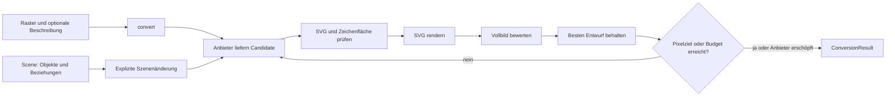

# Etappe 1: Demo ansehen und den Codeweg verstehen

**Stand:** 28. November 2026. Umsetzung auf `codex/exploratory-demo-architecture`,
aufbauend auf `experimental/explorative-conversion`.

Der Umfang dieses Pakets ist eine kleine synthetische Galerie, eine gezielte
Artefaktprüfung und diese Codeübersicht. Aufwandsrahmen: eine kurze
Implementierungsrunde mit anschliessender gezielter Windows-/Linux-CI;
vorläufig etwa eine Stunde Entwicklungsarbeit und wenige Minuten pro CI-Job.
Das sind Schätzungen, keine Zusagen für Kontingentverbrauch. CI-Diagnose und
Reparaturen aus Etappe 2/3 sowie automatische Hypothesenerzeugung aus AP 3/4
bleiben eigene Pakete. Die Konvertierungslogik und Qualitätsgrenzen bleiben
auf dem Stand von AP 2.

## Die Galerie ohne Testinstallation betrachten

1. Im Pull Request den Check **Exploratory acceptance** und seinen Actions-Lauf öffnen.
2. Unter **Artifacts** `exploratory-acceptance-ubuntu-24.04` oder
   `exploratory-acceptance-windows-latest` herunterladen und vollständig entpacken.
3. `gallery/index.html` im Browser öffnen. Alle Links funktionieren offline;
   ein Webserver und eine Python-Installation sind nicht erforderlich.

Jeder bewertete Entwurf zeigt das synthetische Original, das tatsächlich
bewertete SVG und die absolute Kanaldifferenz, zur Sichtbarkeit vierfach
verstärkt (schwarz bedeutet gleiche Pixel). Daneben stehen Pixelziel,
Beststand und vollständige Qualitätswerte. SVG, gerendertes PNG und bei
vorgegebenen Szenen die Szenen-JSON lassen sich einzeln öffnen. `report.json`
enthält Commit, Lauf-URL, Kandidaten-/Rendering-/Bewertungszahlen, Abbruchgrund,
Fehler und Messwerte; `acceptance.xml` enthält die Testergebnisse.
Artefakte werden 30 Tage aufbewahrt und lassen sich danach durch einen neuen
Actions-Lauf erzeugen. Es gibt keine externen Bild- oder Skriptabhängigkeiten.

Die drei Beispiele haben unterschiedliche Aussagekraft:

| Beispiel | Was passiert | Was ist damit belegt? |
| --- | --- | --- |
| Sechs Grundformen | Eine vorgegebene Szene wird gerastert und erneut bewertet. | Darstellung und Messweg, keine Erkennung. |
| Szenenänderungen | Fünf programmierte Kandidaten entfernen ein Objekt, fügen eines hinzu, ändern einen Typ und die Zeichenreihenfolge. `convert` wählt daraus. | Flexible Repräsentation, echte Bewertung und Beststandsauswahl. Die Änderungen werden nicht automatisch erfunden. |
| Automatische AP-1-Baseline | Dasselbe Raster geht mit leerer Beschreibung und ohne Kandidatenvorgabe an `convert`. | Tatsächliche rasterbasierte Rechteck-/Ellipsenvorschläge und Erhalt des unzureichenden besten SVGs. |

Alle Originale sind synthetische Lehrbeispiele. Bei den vorgegebenen Szenen
kennt der Anbieter die Zielgeometrie; das ist kein unabhängiger Qualitäts-
oder Generalisierungsnachweis. Ein bestandenes Pixelziel bedeutet weiterhin
**keine semantische Freigabe** (`released=False`).

## Der Weg eines Bildes



`convert` ist synchron und arbeitet Anbieter reihum ab. Ein fehlgeschlagener
Anbieter blockiert die anderen nicht. Ohne eigene `sources` erzeugt
`_seed_candidates` die kleine Rasterbaseline. Szenenänderungen kommen heute
vom Anbieter; die Rückkopplung von Messwerten zu automatisch gewählten
Struktur- und Parameteränderungen ist erst AP 4.

| Zuständigkeit | Datei und konkrete Anpassungsstelle |
| --- | --- |
| Öffentlicher Einstieg | [src/exploratory/__init__.py](../../src/exploratory/__init__.py): `convert`, `Candidate`, `ConversionResult`, `Scene`, `Primitive`, `Paint`, `Relation`. |
| Ablauf und Auswahl | [engine.py](../../src/exploratory/engine.py): `convert`, Kandidatenprüfung, Rendering, Bewertung, Beststand und kooperatives Budget. `_seed_candidates` erzeugt die automatische Baseline. |
| Geometrische Daten | [scene.py](../../src/exploratory/scene.py): unveränderliche Werte; `add`, `remove`, `update`, `reorder`, `to_dict`, `from_dict`, `to_svg`. |
| Wiederverwendete Mathematik | [adapters.py](../../src/exploratory/adapters.py): `scene_geometry` bindet die vorhandene Geometrieberechnung ohne Beschreibungsparser an. |
| Rendering und Qualitätsmessung | [adapters.py](../../src/exploratory/adapters.py): `render` nutzt den vorhandenen MuPDF-Renderer, `evaluate` Vollbildmetriken und den bestehenden Auswahlscore. |
| Beziehungen | [relations.py](../../src/exploratory/relations.py): diagnostische Fehler für Spiegelung, Parallelität und gemeinsame Anker; keine automatische Geometriekorrektur oder Freigabe. |
| Kommentiertes Beispiel und Ausgabe | [tools/exploratory_demo.py](../../tools/exploratory_demo.py): `examples` definiert Szenen und Änderungen; `generate` übergibt Kandidaten an den Kern und schreibt tatsächlich bewertete Ergebnisse. |
| Gezielte CI | [exploratory.yml](../../.github/workflows/exploratory.yml) und [test_exploratory_demo.py](../../tests/test_exploratory_demo.py): prüft gespeicherte SVG-/PNG-/Differenzdaten, Messwerte, Beststand, Szenenstände und Offline-Links. |

Das Raster am Einstieg und beim Rendering ist ein `uint8`-Array in **BGR**.
`Paint` verwendet **RGB**. Zentren und Grössen sind Anteile der Zeichenfläche,
Winkel sind Umdrehungen (`.25` = 90°). Die Objektreihenfolge ist die
Zeichenreihenfolge; spätere Objekte überdecken frühere. IDs bleiben bei
Typ- und Parameteränderungen erhalten.

## Ein kleines Beispiel im Code verfolgen

In `examples` steht die vollständige Änderungsfolge:

```python
removed = initial.remove("extra")          # Neues Szenenobjekt, initial bleibt erhalten.
added = removed.add(disk)                   # Frei veränderbare Objektanzahl.
changed = added.update("panel", kind="rect")  # Dieselbe ID, anderer Grundformtyp.
target = changed.reorder(("disk", "panel"))   # Rot liegt nun über Blau.
```

Jede Szene wird mit `Candidate.from_scene` zu SVG und strukturierter Szene.
In `generate` reicht ein Anbieter diese Kandidaten an `convert`. Ein schmaler
Bewertungsadapter ruft die unveränderte `adapters.evaluate` auf und speichert
die bewerteten Pixel, SVGs und Messwerte. Die Beststandsauswahl verbleibt in
`convert`. Der JSON-Bericht kennzeichnet anschliessend den vom Kern gewählten
Kandidaten. Die automatische Vergleichsvariante erhält ausschliesslich das
Raster, eine leere Beschreibung und die normalen Standardanbieter.

Für eine sichtbare kleine Änderung kann etwa `disk` in `examples` eine andere
Farbe oder Lage bekommen. Im nächsten CI-Bericht erscheinen die Auswirkungen
in Original, Vorschlägen und Differenzen. Eine neue unterstützte Grundform
erfordert dagegen Änderungen an `Primitive`/`KINDS`, Geometrieadapter und
SVG-Export sowie entsprechende Abnahme. Eine neue Suchstrategie gehört in
einen Kandidatenanbieter beziehungsweise in die spätere Suchsteuerung;
Qualitätsgrenzen werden dafür nicht herabgesetzt.

## Breakpoints und Ausführung

Geeignete Breakpoints sind der `convert`-Aufruf in `generate`, `next(iterator)`
in `engine.convert`, `adapters.render`, `adapters.evaluate` und die Zuweisung
`result.best, result.quality, result.score`. Beobachtbar sind Kandidatenquelle,
`candidate.scene.objects`, `quality`, `score`, `rank` und `result.stop_reason`.
Es gibt keinen zwingenden Workerprozess, der die Breakpoints umgeht.

Der Modulaufruf für den CI-/Remote-Debugpfad lautet:

```text
python -m tools.exploratory_demo --output artifacts/exploratory/gallery
```

Die geltenden Arbeitsregeln erlauben Testkonvertierungen ausschliesslich in
GitHub Actions. Deshalb ist dies kein Auftrag für einen lokalen Debuglauf.
Lokale Breakpoints können zur Codeorientierung vorbereitet werden; die
Ausführung erfolgt in einer entsprechend eingerichteten Actions-Debugsession.
Der normale Workflow erzeugt die Galerie ohne interaktive Debugsession.

Das Zeitlimit ist kooperativ: Ein laufender Anbieter oder Renderer kann nicht
unterbrochen werden. Die Demo hat höchstens 16 Kandidaten und zehn Sekunden
Suchbudget je Beispiel; ein frühes Pixelziel oder erschöpfte Anbieter beendet
sie früher. Das ist keine 300-Sekunden-Exploration.

## Abnahme und verbleibende Arbeit

Die gezielte CI führt AP 1, AP 2 und die Artefaktprüfung auf Windows und
Ubuntu 24.04 mit Python 3.10.11 aus und erzeugt die Galerie auf beiden
Plattformen. Der konkrete Lauf und dessen Ergebnis werden im Pull Request
verlinkt. Keine lokalen Tests oder Konvertierungen.

Die allgemeine Repository-CI bleibt separat sichtbar. Ihre bestehenden Fehler
werden in Etappe 2 nach Ursachen geordnet; dieses Paket behauptet keine
Gesamtabnahme des Legacy-Bestands. Nach dieser Demo ist Etappe 2 das nächste
Arbeitspaket der [vereinbarten Reihenfolge](Weiteres_Vorgehen_nach_AP2.md).
