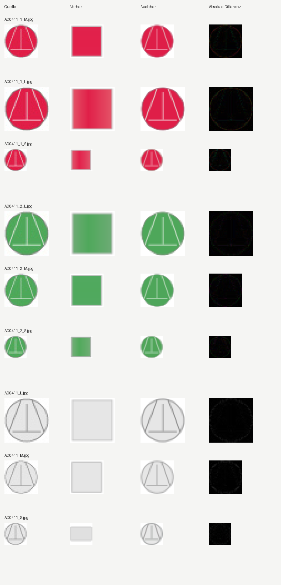

# Arbeitspaket – aufwärts gerichtete Sehnen und Innen-T (2026-10-17)

Basis: `488b4fe82538cc3b869ea7932ef50f3af68d384d`. Nach dem dokumentierten
SE0082-Abschluss folgt regulär `AC0411_1_M`. Alle neun Farb-/Größenvarianten
bestehen beide unveränderten regulären Qualitätsgates ohne Pflichtmetrikregression.
Die sechs farbigen JPGs bestehen außerdem das strenge Plan-B-Pixelgate.
Der zusätzliche graue Vordergrund-IoU-Nachweis bleibt offen.

## Ursache und Korrektur

Die Raster zeigen eine gefüllte Kreisscheibe mit Rand, zwei bis zum Kreisrand
reichende, nach oben zusammenlaufende Sehnen und dazwischen ein umgekehrtes T.
Sein Querstrich liegt unten; der mittige senkrechte Strich endet oben vor dem
Kreisrand. Beide XML-Kataloge enthielten stattdessen unzugeordnete Platzhalter
mit einem irreführenden Griffhinweis. Sie beschreiben jetzt die sichtbaren
Formen eigenständig. Originaltexte, Rasterhashes und Abmessungen sind in
`artifacts/evaluation/upward_circle_linework_recheck_v1/source_inventory.json`
erhalten.

Der bereits vorhandene allgemeine Kreis-/Sehnen-/T-Registrierer unterstützt
diese Richtung. Eine zusätzliche Runtime-Korrektur ist nicht erforderlich.
Kreis, Sehnen, Innenstriche, Lage, Farben und Strichbreiten werden weiterhin aus
jedem Raster neu bestimmt. Die Produktionsdateien, Gates und Quellraster sind
unverändert. Der Algorithmus erhält keine Bildkennungen, festen Katalogparameter
oder Referenz-SVGs. Dies erweitert die Katalogabdeckung eines bestehenden
Registrierers; eine neue allgemeine Szenenerkennung ist damit nicht belegt.

## Frische CLI-Abnahme

Vor der Katalogänderung wurden die alten und vorgeschlagenen Beschreibungen
unter neutralen Dateinamen durch die echte CLI geführt. Ein zweiter Vergleich
verwendet die echten Namen und den vollständigen alten beziehungsweise
korrigierten XML-Katalog. Die gespeicherten SVGs werden unabhängig neu gerendert
und auf Kreis, zwei Randsehnen und die Richtung des Innen-T geprüft.

| Quelle | Mean-Delta² vorher, neutral | Mean-Delta² nachher |
|---|---:|---:|
| AC0411_1_M | 9047.102539 | 200.141113 |
| AC0411_1_L | 8018.450684 | 147.030624 |
| AC0411_1_S | 6371.379883 | 218.692505 |
| AC0411_2_L | 6397.439453 | 73.651253 |
| AC0411_2_M | 6737.937988 | 109.818886 |
| AC0411_2_S | 4955.852539 | 143.247498 |
| AC0411_L | 2290.396973 | 71.587502 |
| AC0411_M | 2017.410034 | 113.993332 |
| AC0411_S | 2665.792480 | 91.345001 |

Beim Ziel sinkt der quadratische Pixelfehler um **97,79 Prozent**. Das ist eine
Fehlerreduktion, keine Prozentangabe zur wahrgenommenen Bildqualität.



Die drei grauen JPGs verfehlen ausschließlich die zusätzliche strenge
Vordergrund-IoU-Grenze von `0.85`: L `0.750923`, M `0.611628`, S `0.809524`.
Die helle JPEG-Fläche liegt an der unveränderten Vordergrundschwelle. Dieser
Folgepunkt heißt `AC0411-PB-GREY`; beide regulären Gates bestehen bereits.
Keine Quelle, kein akzeptiertes Bestresultat und keine Grenze wurde dafür
angepasst.

Die ersten Vergleiche hatten keinen festen Suchseed. Die zusätzliche
Portfoliosuche für die grauen Fälle fand dadurch leicht unterschiedliche
Farbwerte in den beiden Namenskontexten. Diese Diagnose bleibt unter
`diagnostics_unseeded/` erhalten. Mit `ICC_SEARCH_SEED=0` liefern alle neun
finalen Katalogfälle **bytegleiche SVGs** zu den neutral benannten Fällen.
Die Baselines mit ursprünglichen Beschreibungen werden ebenfalls reproduziert.
Die dokumentierten Endwerte stammen ausschließlich aus diesen gesetzten Läufen.

Alle Vergleiche verwenden `semantic-only`, deterministische Reihenfolge und
64 angeforderte Anfangsiterationen. Die bestehende automatische Nachbesserung
kann weitere Durchgänge auslösen; die vollständigen CLI-Logs erhalten deren
tatsächliche Budgets. Der analytische Registrierer hat zusätzlich seine eigene
begrenzte Renderoptimierung. Die Zahl 64 ist kein Gesamtbudget für Renderaufrufe.
Verbotene Referenz-SVG-Lesezugriffe: **null**.

Eine unabhängig konstruierte blaue Vorlage verändert Zeichenfläche, Lage,
Radius, Sehnensteigung, Strichbreiten und Palette. Zwei echte CLI-Batterien
mit Seeds `20261017` und `20261018` bestehen jeweils **17/17** Fälle. Ihre
Eingaberaster, Referenzen, tatsächlichen Ausgabe-SVGs, Logs und Einzelmesswerte
bleiben erhalten. Die Referenz wird ausschließlich im Prüftreiber rasterisiert;
der Konverter darf sie nicht lesen. Ein zusätzlicher Regressionstest prüft die
neun Katalogbeschreibungen in beiden XML-Dateien, Rasterhashes, Vektortopologie
und die regulären beziehungsweise ausdrücklich noch fehlenden strengen Nachweise.

## Bestand und nächste Rotation

Die Erfolgsübersicht enthält **365 Paare**. Alle **355 tatsächlich im Basisstand
vorhandenen Indexeinträge**, Originalbilder und Bestresultate bleiben unverändert.
Zusätzlich zu den neun neuen Paaren wurde der fehlende Archivindexeintrag des
bereits zuvor abgenommenen `SE0082` samt nachgeprüftem Bild-/SVG-Paar ergänzt.
Dessen vorheriger Bericht nannte 356 Paare, während der ausgecheckte Index nur
355 enthielt. `archive_safety.json` trennt diese Wiederherstellung von den neun
neuen Abnahmen.

Der erneuerte Review enthält weiter 1.000 Einträge und 993 renderbare Paare.
Alle 48 bisherigen Bestenlisteneinträge bestehen ihre Reviewgrenze. Frühere
Ausschlüsse bleiben erhalten; nur die neun regulär abgenommenen Varianten
kommen hinzu. Nächste Rotation: **`AC0910_L`, `GE0204_M`, `AC0921_M`, `AC0232_M`**.
Die grauen Folgepunkte und die allgemeinen Architekturaufgaben bleiben offen.

## Abschlussprüfungen

Die vollständige normale Pytest-Sammlung deckt alle **3.398 gesammelten
Testknoten genau einmal** ab: **3.368 bestanden, 30 regulär übersprungen,
null Fehler**. Die drei schweren Konvertierungsmodule bleiben wie bisher
vom normalen Profil ausgenommen. Alle neun neuen Katalogregressionen sind
enthalten. Die vier ursprünglichen XML-Berichte, Logs, Testknoten und der
zusammengeführte Bericht sind im Nachweisordner aufbewahrt.

Zusätzlich bestehen `compileall`, CLI-Hilfe und die Bild-ID-Hardcoding-Nullprüfung.
`git diff --exit-code` bestätigt, dass `src`, `tools` und `config` gegenüber
dem Basiscommit unverändert sind. Die Hashes der Produktionsdateien, der
geänderten Kataloge und des neuen Regressionstests stehen in `source_sha256.json`.

Alle **355 bisherigen Archivbilder** wurden aus geschützten Kopien mit der
echten CLI erneut konvertiert: 307 in `semantic-only` und 48 als gemeinsame
Kompatibilitätsgruppe in `standard`. Alle bestehen die bisherige absolute
Archiv-Pixelgrenze. Sämtliche 355 neu gerenderten Ausgaben sind zum vorherigen
CLI-Nachweis pixelgleich; kein Fall wird schlechter. Die bekannten 22
historischen Abweichungen gegenüber gespeicherten Bestresultaten bleiben
ausdrücklich sichtbar. Eine bestandene Archivgrenze ist weder der Nachweis
eines erreichten Bestresultats noch die strengere Plan-B-Abnahme.

Der wiederhergestellte SE0082-Eintrag besteht außerdem seine eigene frische
CLI-Neukonvertierung. Die neuen neun Fälle haben die oben dokumentierte
neutrale und vollständige Katalogprüfung. Der unabhängige Verifikator prüft
Hashwerte, Originalraster, gespeicherte Vektoren, reguläre und strenge Gates,
beide unabhängigen Batterien, Bestandsschutz und den vollständigen Testnachweis
erneut. `git diff --check` besteht ebenfalls.

## Reproduktion

Frische CLI-Ausgaben benötigen neue, kurze Ausgabepfade. Der Verifikator rendert
die aufbewahrten SVGs erneut und führt keine Neukonvertierung aus.

```powershell
$env:ICC_SEARCH_SEED = '0'
$env:IMAGE_CONVERTER_ISOLATE_SVG_RENDER = '0'
.venv/Scripts/python.exe artifacts/evaluation/upward_circle_linework_recheck_v1/verify_evidence.py
.venv/Scripts/python.exe -m tools.run_oriented_circle_linework_recheck artifacts/evaluation/upward_circle_linework_recheck_v1/manifest.json --output-dir .tmp/up-reproduction
.venv/Scripts/python.exe artifacts/evaluation/upward_circle_linework_recheck_v1/recheck_catalog_context.py --output-dir .tmp/up-catalog-reproduction
.venv/Scripts/python.exe -m tools.run_plan_b_variations --svg artifacts/evaluation/upward_circle_linework_recheck_v1/independent.svg --description-file artifacts/evaluation/upward_circle_linework_recheck_v1/independent.txt --seed 20261017 --output-dir .tmp/up-independent-reproduction --keep-debug-artifacts
.venv/Scripts/python.exe -m pytest --basetemp .tmp/up-tests-reproduction
.venv/Scripts/python.exe -m tools.recheck_satisfactory_archive --output-dir .tmp/up-archive-reproduction --max-cases-per-worker 64
.venv/Scripts/python.exe -m compileall -q src tests tools
.venv/Scripts/python.exe -m src.imageCompositeConverter --help
.venv/Scripts/python.exe -m tools.check_no_new_image_id_hardcoding
git -c core.whitespace=cr-at-eol diff --check
```
