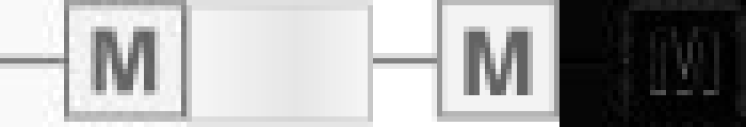

# Arbeitspaket – Quadrat mit linkem Griff und horizontalem M (2026-10-17)

Branch: `codex/se0082-quality-2026-10-17`, Basis: `d662a3e0f`.
Das nächste reguläre Ziel `SE0082` besteht beide unveränderten regulären
Qualitätsgates ohne Pflichtmetrikregression und zusätzlich das strenge
Plan-B-Pixelgate. Zwei unabhängig gesetzte Variations-Seeds bestehen jeweils
**17/17 echte CLI-Fälle**.

## Ursache und allgemeine Korrektur

Das Raster zeigt ein gefülltes Quadrat mit Kontur, mittigem Griff nach links
und horizontalem `M`. Die alte Beschreibung verwies lediglich auf `SE0041`.
Beide XML-Kataloge beschreiben nun die sichtbaren Formen eigenständig;
Maße, Lage, Strichstärken, Farbe und Schriftgröße bleiben Rasterbefunde.
Die Quellbilder wurden nicht verändert.

Eine Beschreibungskorrektur allein reicht nicht: Der vorhandene Textfit
unterstützte nur Griffe nach unten und rechts. Der linke Weg normalisiert
Geometrie und Raster durch Spiegelung und nutzt den vorhandenen Registrierer.
Jeder Kandidat wird zuerst im Originalrahmen mit aufrechter Schrift gerendert.
Dadurch bleiben auch asymmetrische Zeichen wie `P` und `p` richtig orientiert.
Das finale SVG enthält nur einen Griffpfad, ein Rechteck und Text; keine
Transformation, Vektorvorlage oder Rastereinbettung wird benötigt.

Die Richtungsbedingung unterscheidet den Griff von der Verschiebung des ganzen
Motivs. „Nach rechts und unten versetzt“ darf den beschriebenen linken Griff
nicht ausschalten. Für die Schriftkalibrierung wird ein ausdrücklich leeres
Label verwendet: Das Entfernen des Felds aktivierte beim historischen linken
Formtyp sonst dessen Standardbuchstaben `T`.

Ein blasser antialiasierter Rand kann bei absolutem Farbfehler ein falsches
lokales Optimum bilden. Der neue linke Weg vergleicht deshalb quadratische
Farbreste und verfeinert Randfarbe, Breite und Rechteck gemeinsam. Die finale
Auswahl muss zusätzlich den ursprünglichen Fehler des Aufrufers verbessern.
Die bestehenden unteren und rechten Verfahren behalten ihre Auswahlregeln.

Eine lokale Silhouettenprüfung vergleicht das gerenderte Zeichen mit dem
beobachteten Kontrast im Quadrat. Die Gegenprobe „`P` im Raster, `M` in der
Beschreibung“ bestand zunächst sogar das globale strenge Pixelgate. Sie wird
jetzt vom neuen Registrierer abgelehnt. Dies ist eine begrenzte Prüfung des
explizit beschriebenen Zeichens, keine allgemeine OCR-Zusage.

## Eingefrorene Baseline und tatsächliche gespeicherte CLI-Ausgaben

| Kontext | Mean-Delta² vorher | Mean-Delta² nachher |
|---|---:|---:|
| Neutraler Dateiname, ursprüngliche Beschreibung | 8076.846191 | 700.750000 |
| Echter Dateiname und vollständiger ursprünglicher Katalog | 9116.978516 | 700.750000 |

Die neutrale Baseline wurde vor der Produktionsänderung eingefroren. Eine
separate Beschreibung-only-Ablation auf dem unveränderten Code verfehlt das
strenge Gate (`normalized_mse=0.155946`). Für den echten Namen wurde der
ursprüngliche Code aus dem Basiscommit exportiert und mit dem vollständigen
alten Katalog ausgeführt. Der gleiche alte Katalog liefert auch mit neuem
Code bytegleich die alte Ausgabe. Mit korrigiertem Katalog ist die finale
Ausgabe bytegleich zum neutral benannten Fall. Die finale neutrale Wiederholung
reproduziert ebenfalls beide SVG-Hashes.

Der normalisierte quadratische Pixelrest sinkt beim neutralen Ziel von
`0.04140380` auf `0.00359221`. Kantenübereinstimmung `0.882000`, reguläre
Objektmasken-IoU `0.931818` und strenge Vordergrund-IoU `0.869281` bestehen
die bisherigen Grenzen. Kein Gate, Originalraster oder gespeichertes
Bestresultat wurde für die Abnahme angepasst.

Alle CLI-Aufrufe nutzen `semantic-only`, deterministische Reihenfolge und
64 angeforderte Iterationen. Die vorhandene Nachbesserung kann einen weiteren
Durchgang auslösen; die Logs erhalten die tatsächlichen Aufrufe. Die analytische
Registrierung hat eine eigene begrenzte Kandidatensuche. Deren Renderkosten
sind nicht mit den angeforderten CLI-Iterationen gleichzusetzen.
Verbotene Referenz-SVG-Lesezugriffe: **null**.

Links Original, daneben ursprüngliche Ausgabe, neue Ausgabe und absolute
Pixeldifferenz zur neuen Ausgabe (sechsfache Pixelansicht):



## Hypothesen, gescheiterte Versuche und unabhängige Gegenproben

Die unabhängig konstruierte beige Vorlage verändert Zeichenfläche, Lage,
Geometrie, Kontur, Farben und Buchstabe (`P`). Sie wird ausschließlich vom
Prüftreiber rasterisiert; ihre Vektoren sind dem Konverter gesperrt.

| Geprüfte Hypothese | Original + 16 Varianten, Seed 20261017 |
|---|---:|
| Beschreibung und gespiegelter vorhandener Textfit | 7/17; Verschiebungstext sperrt die richtige Topologie |
| Griffrichtung vom Verschiebungstext trennen, absoluter Farbfehler | 16/17; blasser falscher Konturrand bei `probe_07` |
| Gemeinsame Konturregistrierung mit quadratischem Fehler, echte leere Schriftkalibrierung und lokale Zeichenprüfung | 17/17 |

Ein zweiter finaler Seed `20261018` besteht ebenfalls 17/17. Alle Versuche
verwenden dieselben bestehenden Pixelgrenzen und dieselbe unabhängige Vorlage.
Die finalen Fits benötigen **176–224 tatsächliche Rendereraufrufe je Fall**;
das Katalogziel benötigt **208**. Der Zähler umfasst auch Schriftkalibrierung,
Ausgangsbild und leeres Vergleichsbild. Das ältere Feld `evaluations` zählt
nur bewertete Kandidaten und ist deshalb kein vollständiger Renderzähler.
Die früheren Versuche haben diesen vollständigen Zähler noch nicht; ihre
Laufzeiten begründen wegen nebenläufiger Tests keine Beschleunigungsquote.

Die 44 neuen Tests behandeln unter anderem `P`, `p`, `M`, `T`, halbe/doppelte
Auflösung, andere Farben, alle 16 Subpixellagen, fehlenden/getrennten Griff,
fehlende Schrift, zusätzliche Objekte, widersprüchliche Beschreibungen,
falsche Zeichen, Rendererfehler und nichtendliche Messwerte. Zusammen mit
den betroffenen bestehenden Modulen bestehen **155 gezielte Tests**.

Nachweise und unabhängiger Verifikator:
[`left_stem_labeled_square_recheck_v1/`](../../artifacts/evaluation/left_stem_labeled_square_recheck_v1).
Die beiden fehlgeschlagenen Batterien bleiben mit ihren fehlerhaften Ausgaben,
Rastereingaben, Referenzen, Messwerten und CLI-Logs als Diagnose erhalten.

## Bestand und nächste Rotation

Die Erfolgsübersicht enthält **356 Paare**; sämtliche 355 bisherigen
Indexeinträge sowie deren Originalbilder und SVGs bleiben unverändert.
Der erneuerte Review enthält 1.000 Einträge und 993 renderbare Paare.
Alle 48 bisherigen Bestenlisteneinträge bestehen weiterhin ihre Reviewgrenze.
Nur `SE0082` wird zusätzlich ausgeschlossen. Nächste reguläre Rotation:
`AC0411_1_M`, `AC0910_L`, `GE0204_M`, `AC0921_M`, `AC0232_M`.
Die anderen Richtungen `SE0083` und `SE0084` gehören nicht zu dieser Abnahme.
Die übrigen offenen Aufgaben bleiben erhalten.

Alle **355 bisherigen Archivbilder** wurden aus geschützten Kopien mit der
echten CLI erneut konvertiert: 307 semantische Fälle und die gemeinsame
48-Fälle-Kompatibilitätsgruppe. Alle bestehen die bisherige absolute
Archiv-Pixelgrenze. Alle 355 neuen SVGs sind nach erneutem Rendern pixelgleich
zum vorherigen CLI-Nachweis; es gibt keine neue Regression. Die bekannten
22 historischen Kompatibilitätsabweichungen gegenüber gespeicherten
Bestresultaten bleiben ausdrücklich sichtbar. Archivgrenze, historische
Bestresultate und die strengeren Plan-B-Gates sind unterschiedliche Prüfungen.
Die archivierten Bestresultate wurden nicht ersetzt.

Die vier vollständigen Standardtestgruppen und die finale Wiederholung der
betroffenen Module decken alle **3.389 aktuell gesammelten Testknoten genau
einmal** ab: **3.359 bestanden, 30 regulär übersprungen, null Fehler**.
Die beiden zuletzt ergänzten Negativ-/Renderzählertests sind durch die finale
155-Test-Wiederholung abgedeckt. Die ursprünglichen vier XML-Berichte bleiben
erhalten; `standard_profile.xml` enthält pro aktuellem Testknoten den letzten
Nachweis. Zusätzlich bestehen `compileall`, CLI-Hilfe, die Runtime-
Bild-ID-Nullprüfung und `git diff --check`.

Einzelwerte, SVGs und XML-Nachweise stehen in `archive_recheck.json`,
`archive_reconverted_svgs/`, `standard_profile_summary.json` und `checks/`
im Nachweisordner. Der Verifikator misst auch alle gespeicherten
Archiv-Neukonvertierungen und ihren Vergleich unabhängig erneut.

## Reproduktion

Der Verifikator rendert gespeicherte Ergebnisse erneut, ohne eine Konvertierung
auszuführen. Neue CLI-Läufe benötigen frische, kurze Ausgabeverzeichnisse.

```powershell
$env:IMAGE_CONVERTER_ISOLATE_SVG_RENDER = '0'
.venv/Scripts/python.exe artifacts/evaluation/left_stem_labeled_square_recheck_v1/verify_evidence.py
.venv/Scripts/python.exe -m tools.run_labeled_description_recheck artifacts/evaluation/left_stem_labeled_square_recheck_v1/manifest.json --output-dir .tmp/left-square-reproduce
.venv/Scripts/python.exe artifacts/evaluation/left_stem_labeled_square_recheck_v1/recheck_catalog_context.py --output-dir .tmp/left-square-catalog-reproduce
.venv/Scripts/python.exe -m tools.run_plan_b_variations --svg artifacts/evaluation/left_stem_labeled_square_recheck_v1/independent.svg --description-file artifacts/evaluation/left_stem_labeled_square_recheck_v1/independent.txt --seed 20261017 --output-dir .tmp/left-square-independent-reproduce --keep-debug-artifacts
.venv/Scripts/python.exe -m pytest -q tests/test_left_stem_labeled_square_runtime.py tests/test_right_stem_labeled_square_runtime.py tests/test_labeled_square_runtime.py tests/test_left_stem_marked_square_runtime.py --basetemp .tmp/left-square-tests-reproduce
.venv/Scripts/python.exe -m compileall -q src tests tools
.venv/Scripts/python.exe -m tools.check_no_new_image_id_hardcoding
git -c core.whitespace=cr-at-eol diff --check
```
