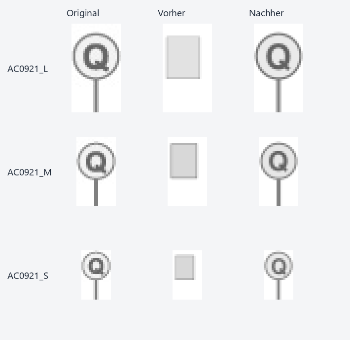

# Arbeitspaket – Kreisscheibe mit Q und unterem Griff (2026-10-18)

Branch: `codex/ac0921-quality-2026-10-18`, Ausgangsstand `8c0d2ab66`.
Nach der GE0204-Abnahme war `AC0921_M` das nächste dokumentierte Ziel.
Die Größen L/M/S werden gemeinsam geprüft.

## Ursache und allgemeine Änderung

Beide XML-Kataloge enthielten unzugeordnete Platzhalter. Die drei Bilder zeigen
eine einfarbig hellgraue Kreisscheibe mit dunkler Randkontur, einem mittigen
senkrechten unteren Griff und dem dunklen Großbuchstaben Q. Alle drei Einträge
in beiden Katalogen beschreiben jetzt diese sichtbare Form eigenständig.
Die ursprünglichen Beschreibungen und unveränderten Rasterhashes sind gesichert.

Die bestehende Kreis-/Buchstabenregistrierung unterstützt nun auch einen
ausdrücklich beschriebenen unteren Griff. Kreiszentrum und Radius entstehen aus
oberer Kontur und Kreisflanken; der Griff darf den Kreisfit nicht nach unten
ziehen. Ein zusammenhängender, schmaler, mittiger Rasterstreifen liefert Länge,
Breite und Farbe. Der endgültige SVG enthält Hintergrund, native Linie, Kreis
und nativen Text. Geometrie und Farben werden für jedes Bild neu bestimmt.

Die vorhandene Prüfung der Buchstabensilhouette bleibt erhalten. Bei einem
großen unabhängigen P blieb die rein schrittweise Suche in einem lokalen
Minimum hängen: Schriftgröße und Position mussten gleichzeitig geändert werden.
Nur wenn ein neuer Griff-Fit diese Prüfung verfehlt, vergleicht ein begrenztes
Raster aus 27 gemeinsamen Schriftlagen und -größen zusätzliche Kandidaten.
Anschließend verfeinert derselbe Rasterfit den besten Kandidaten. Eine erneut
verfehlte Buchstabenprüfung verwirft die Rekonstruktion. Die bisherigen
Kreisscheiben ohne Griff durchlaufen keine zusätzliche Suche.

Fehlende, abgetrennte, zu breite oder versetzte Griffe, zusätzliche Objekte,
falsche Buchstaben sowie widersprüchliche Beschreibungen werden in den
Regressionen abgewiesen. Der neue Weg unterstützt einen unteren Griff;
allgemeine OCR und beliebige Anschlussrichtungen sind damit nicht nachgewiesen.
Die Runtime enthält keine Bildkennungen, Katalogkoordinaten oder Referenz-SVGs.

## Tatsächliche CLI-Abnahme

Der Vorlauf wurde vor der Runtime-Änderung mit alten Beschreibungen und neutralen
Dateinamen eingefroren. Der finale Lauf reproduziert diese SVGs bytegleich.
Ein weiterer Vergleich verwendet Originalnamen sowie vollständige alte und
korrigierte Kataloge. Die finalen SVGs sind zwischen beiden Namenskontexten
bytegleich. Alle Konvertierungen verwenden `semantic-only`; der Zugriffswächter
meldet null verbotene Referenz-SVG-Lesezugriffe.

| Quelle | Mean-Delta² vorher, neutral | Mean-Delta² nachher |
|---|---:|---:|
| AC0921_M | 6730.307129 | 619.872864 |
| AC0921_L | 6946.463867 | 271.082672 |
| AC0921_S | 6627.768066 | 418.015991 |

Alle drei gespeicherten Ausgaben bestehen nach unabhängigem Rendern beide
unveränderten regulären Gates ohne Pflichtmetrikregression und zusätzlich die
strengeren Plan-B-Pixelgates. Die Fehlerreduktion beträgt 90,8–96,1 %;
dies ist keine Prozentangabe zur wahrgenommenen Bildqualität.



Eine unabhängig konstruierte grüne Vorlage verändert Zeichenfläche, Position,
Proportionen, Palette und Buchstabe (R). Die tatsächliche CLI-Batterie mit Seed
`20261018` besteht **17/17 Fälle**. Alle Eingaben, Referenzen, gespeicherten
Ausgaben, Hashes und Logs bleiben erhalten; der Verifikator rendert sie erneut
und prüft zusätzlich Kreis, exakten Buchstaben und angeschlossenen unteren Griff.
Neun weitere algorithmische Tests decken Q/R/P, drei Größen und andere Lagen ab.

## Bestand und nächste Aufgabe

Die Erfolgsübersicht enthält **374 Paare**. Alle **371 bisherigen Datensätze**,
Originalbilder und Bestresultate bleiben anhand ihrer Hashes unverändert.
Nur die drei ausdrücklich abgenommenen AC0921-Größen werden ergänzt.

Alle **371 bisherigen Archivbilder** wurden mit der tatsächlichen CLI aus
geschützten Kopien neu konvertiert: 323 semantische Fälle und die gemeinsame
48-Fälle-Kompatibilitätsgruppe. **371/371** bestehen die unveränderte absolute
Archiv-Pixelgrenze. Alle neu gerenderten Ausgaben sind pixelgleich zu ihrem
vorherigen CLI-Stand bei gleichem Suchseed. Die gespeicherten Bestresultate
bleiben unverändert. Archivgrenze und strenge Paketgates sind separate Prüfungen.

Der erste Archivversuch scheiterte in einem Kindprozess beim Schreiben von
`batch_failure_summary.csv` mit Windows-Fehler `OSError 22`. Die bereits
erfolgreichen 99 Fälle bleiben erhalten; der abgebrochene Prozess zählt nicht
als Abnahme. Sechs frische Prozesse mit höchstens 50 Fällen wiederholen die
übrigen 272 Fälle vollständig erfolgreich. Fehlerlog und Wiederholungsbefehl
bleiben unter `checks/` erhalten.

Neben den 22 bekannten historischen Kompatibilitätsabweichungen vom gespeicherten
Bestresultat bleibt eine bestehende Seed-Abhängigkeit von `AC0910_S` sichtbar:
mit Archivseed 0 beträgt Mean-Delta² `1076.560059`, mit dem Abnahmeseed 20261017
`656.862244`. Eine zusätzliche echte CLI-Gegenprobe lädt das einzige geänderte
Runtime-Modul aus dem Elternstand `8c0d2ab66` und vergleicht es mit dem neuen
Modul bei identischem Archivseed. Alle drei Lux-Größen sind dabei vorher/nachher
bytegleich; die S-Abweichung ist bereits im Elternstand vorhanden. Eingaben,
unveränderte Beschreibung, eingefrorener Modultext, Ausgaben und Logs sind
über `archive_control/` und `parent_labeled_disk.py.txt` nachprüfbar.

Der erneuerte Review umfasst weiterhin 1.000 Datensätze und 993 renderbare
Paare. Alle 48 bisherigen Bestenlisteneinträge bestehen die unveränderte
Grenze. Frühere Ausschlüsse bleiben erhalten; zusätzlich ausgeschlossen sind
ausschließlich AC0921 L/M/S. Nächste reguläre Rotation: **`AC0232_M`**.
Bestehende offene Aufgaben bleiben erhalten.

## Abschlussprüfungen

Vier frische Testprozesse decken alle **3.429 frisch gesammelten Testknoten
exakt einmal** ab: **3.399 bestanden, 30 regulär übersprungen, null Fehler**.
Beide zusätzlichen AC08-/AC0100-Konvertierungs-Smokes, `compileall`, CLI-Hilfe,
Runtime-Bild-ID-Nullprüfung und `git diff --check` bestehen ebenfalls.
Einzelberichte, vollständige Logs und die Knotenliste liegen unter `checks/`;
`standard_profile.xml` und `standard_profile_summary.json` fassen sie zusammen.
Der eigenständige Verifikator prüft die gespeicherten Abnahmen und alle
bisherigen Archivhashes erneut. Die Archiv-Neukonvertierung ist zusätzlich in
`archive_recheck.json` dokumentiert.

## Reproduktion

Nachweise: `artifacts/evaluation/bottom_stem_letter_disk_recheck_v1/`.

```powershell
.venv/Scripts/python.exe artifacts/evaluation/bottom_stem_letter_disk_recheck_v1/verify_evidence.py
.venv/Scripts/python.exe artifacts/evaluation/bottom_stem_letter_disk_recheck_v1/run_evidence.py --output-dir .tmp/ac0921-replay-new
.venv/Scripts/python.exe -m tools.run_plan_b_variations --svg artifacts/evaluation/bottom_stem_letter_disk_recheck_v1/independent.svg --description-file artifacts/evaluation/bottom_stem_letter_disk_recheck_v1/description.txt --seed 20261018 --output-dir .tmp/ac0921-independent-new --keep-debug-artifacts
.venv/Scripts/python.exe -m tools.recheck_satisfactory_archive --max-cases-per-worker 50 --output-dir .tmp/ac0921-archive-new
.venv/Scripts/python.exe artifacts/evaluation/bottom_stem_letter_disk_recheck_v1/run_archive_control.py --output-dir .tmp/ac0921-parent-control-new
.venv/Scripts/python.exe -m pytest --basetemp .tmp/ac0921-tests-new
.venv/Scripts/python.exe -m compileall -q src tests tools
.venv/Scripts/python.exe -m src.imageCompositeConverter --help
.venv/Scripts/python.exe -m tools.check_no_new_image_id_hardcoding
git -c core.whitespace=cr-at-eol diff --check
```
