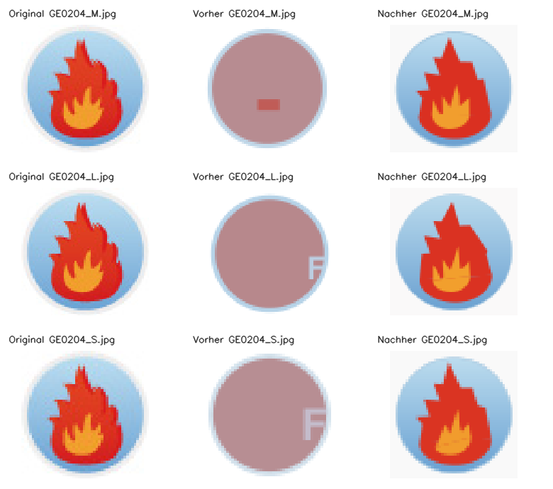

# Arbeitspaket – verschachtelte Flammen auf Verlaufsscheibe (2026-10-18)

Branch: `codex/ge0204-quality-2026-10-17`, Ausgangsstand `9c155ba8e`.
Das nächste reguläre Ziel nach AC0910 war `GE0204_M`; die beiden Größen L/S
wurden als Familie mitgeprüft.

## Ursache und Änderung

Die alte Beschreibung verwies auf einen anderen Hintergrund und bezeichnete
das Symbol nur als komplex und möglicherweise nicht automatisierbar. Sie
beschrieb weder den vertikalen Scheibenverlauf noch die beiden aufrechten,
verschachtelten Flammen mit spitzen Zungen und gerundetem Bauch vollständig.
Beide XML-Kataloge enthalten jetzt dieselbe eigenständige Beschreibung.

Der bereits für `b_heating1` vorhandene allgemeine Flammenfit verarbeitet alle
drei Raster unverändert. **Produktionscode und Qualitätsgrenzen wurden nicht
geändert.** Geometrie und Farben werden aus dem jeweiligen Eingaberaster
ermittelt; die Runtime erhält keine Bildkennungen oder gespeicherten Vektoren.
Die alten Beschreibungen und unveränderten Quellhashes bleiben im Manifest.

## Tatsächliche CLI-Abnahme

Der Vorlauf wurde vor der Beschreibungskorrektur unter neutralen Namen
eingefroren. Der finale Lauf reproduziert diese alten SVGs bytegleich.
Zusätzlich wurden Originalnamen mit vollständigem altem und korrigiertem
Katalog geprüft. Die drei finalen SVGs sind zwischen beiden Namenskontexten
bytegleich. Alle bestehen beide regulären Gates ohne Pflichtmetrikregression
und zusätzlich die strengeren Plan-B-Pixelgates.

| Quelle | Mean-Delta² vorher, neutral | Mean-Delta² nachher |
|---|---:|---:|
| GE0204_M | 9131.669922 | 358.126678 |
| GE0204_L | 8808.500000 | 505.091034 |
| GE0204_S | 9240.787109 | 372.695587 |

Das entspricht einer Fehlerreduktion von 94,3–96,1 %, keiner Prozentangabe zur
wahrgenommenen Bildqualität. Die unabhängige Semantikprüfung verlangt einen
Verlaufskreis und genau zwei verschiedenfarbige, vollständig verschachtelte
Flammen mit spitzen Zungen und gerundeten Unterteilen. Gespeicherte SVGs werden
erneut gerendert; alle CLI-Konvertierungen verwenden `semantic-only`.
Der Zugriffswächter meldet null verbotene Referenz-SVG-Zugriffe.



Eine unabhängig konstruierte Vorlage mit anderer Zeichenfläche, Lage,
Flammengeometrie und Palette ergänzt die drei Originalraster. Die tatsächliche
CLI-Variantenprüfung mit Seed `20261018` besteht **17/17 Fälle**. Eingaben,
Referenzen, gespeicherte Ausgaben, Hashes und Logs bleiben unter `independent/`
erhalten. Alle Ausgaben wurden unabhängig erneut gerendert und semantisch geprüft.

## Archiv und nächste Aufgabe

Die Erfolgsübersicht enthält jetzt **371 Paare**. Alle **368 bisherigen
Datensätze**, Originalbilder und Bestresultate bleiben anhand ihrer Hashes
unverändert. Da kein Produktionscode geändert wurde, wird hier kein neuer
vollständiger CLI-Archivlauf behauptet. Die drei neuen Fälle wurden unabhängig
nachgemessen und ausdrücklich abgenommen.

Der erneuerte Review umfasst weiter 1.000 Datensätze und 993 renderbare Paare.
Alle 48 bisherigen Bestenlisteneinträge bestehen ihre unveränderte Grenze.
Nur die drei abgenommenen GE0204-Größen kommen zu den bisherigen Ausschlüssen
hinzu. Nächste Rotation: **`AC0921_M`, `AC0232_M`**.

## Abschlussprüfungen

Vier frische Testprozesse decken alle **3.404 frisch gesammelten Testknoten
exakt einmal** ab: **3.374 bestanden, 30 regulär übersprungen, null Fehler**.
Die einzelnen XML-Berichte, vollständigen Logs und die Knotenliste liegen unter
`checks/`; `standard_profile.xml` und `standard_profile_summary.json` enthalten
den zusammengeführten Nachweis. Der erste Versuch im System-Temp-Verzeichnis
scheiterte an Windows-Schreibrechten; die erfolgreichen Prozesse verwenden
eigene temporäre Verzeichnisse innerhalb des Projekts.

`compileall`, CLI-Hilfe, die Prüfung auf neue Runtime-Bildkennungen und
`git diff --check` bestehen ebenfalls. Der eigenständige Verifikator bestätigt
alle sechs gespeicherten CLI-Vergleiche, 17 unabhängigen Fälle, die vollständige
Testknotenabdeckung und sämtliche bisherigen Archivhashes.

## Schätzung der verbleibenden Arbeit

Vor diesem Paket enthielt `open_tasks.md` **38 offene Checkboxen**. Darunter
sind Sammelaufgaben, überlappende historische Unteraufgaben und dauerhafte
Arbeitsregeln; das sind keine 38 gleich großen, vollständig abgegrenzten Pakete.

Von 1.785 verschiedenen Katalog-JPGs waren 368 ausdrücklich archiviert;
1.417 hatten noch keine ausdrückliche Abnahme. 588 XML-Einträge enthalten
solche Bilder. Ein weiteres nicht abgenommenes Bild ist diesen Einträgen nicht
zugeordnet. Bei einem Paket pro XML-Familie ergibt das grob **590
Familienprüfungen für eine vollständige Katalogsichtung**. Nach GE0204 sind es
587 solche XML-Familien und 1.414 Bilder ohne ausdrückliche Archivabnahme.

Das ist eine Umfangsschätzung, keine Zahl gescheiterter Konvertierungen und
keine belastbare Aufwandsschätzung. Familien können gemeinsame Algorithmen
nutzen und zusammen bearbeitet werden; komplizierte Motive können mehrere
Schritte benötigen. Vollständige Katalogabdeckung ist laut Roadmap kein
Abschlusskriterium. Die technische Aufgabenliste und die Familienzahl dürfen
wegen ihrer Überschneidungen nicht einfach addiert werden.
Zählbasis und Familienliste: `backlog_snapshot.json` im Nachweisordner.

## Reproduktion

Nachweise: `artifacts/evaluation/nested_flame_disk_recheck_v1/`.

```powershell
.venv/Scripts/python.exe artifacts/evaluation/nested_flame_disk_recheck_v1/verify_evidence.py
.venv/Scripts/python.exe artifacts/evaluation/nested_flame_disk_recheck_v1/run_evidence.py --output-dir .tmp/ge0204-replay
.venv/Scripts/python.exe -m tools.run_plan_b_variations --svg artifacts/evaluation/nested_flame_disk_recheck_v1/independent.svg --description-file artifacts/evaluation/nested_flame_disk_recheck_v1/description.txt --seed 20261018 --output-dir .tmp/ge0204-independent-replay --keep-debug-artifacts
.venv/Scripts/python.exe -m pytest --basetemp .tmp/ge0204-tests
.venv/Scripts/python.exe -m compileall -q src tests tools
.venv/Scripts/python.exe -m src.imageCompositeConverter --help
.venv/Scripts/python.exe -m tools.check_no_new_image_id_hardcoding
git -c core.whitespace=cr-at-eol diff --check
```
