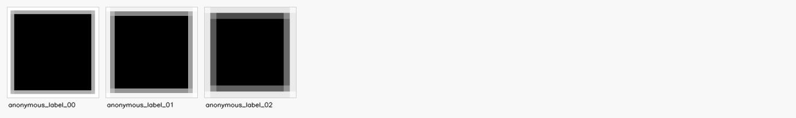
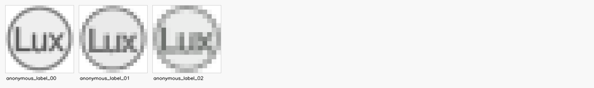

# Arbeitspaket – Kreisscheibe mit Lux (2026-10-17)

Branch: `codex/merge-audit-ac0910-2026-10-17`, Ausgangsstand `0f443a67f`.
Die vorausgehende [Merge-Prüfung](merge_audit_2026-10-17.md) stellt den
widersprüchlichen Archiv- und Aufgabenstand wieder her. Das jüngste erhaltene
Arbeitspaket AC0411 bestimmt `AC0910_L` als nächstes reguläres Ziel.

## Ursache und allgemeine Änderung

Die drei Raster L/M/S zeigen eine hellgraue Kreisscheibe mit dunkler Kontur und
mittiger serifenloser Beschriftung `Lux`. Beide XML-Kataloge enthielten
unzugeordnete Platzhalter mit einem irreführenden Griffhinweis. Sie beschreiben
jetzt die sichtbare Form eigenständig. Die alten Beschreibungen, Abmessungen
und Quellhashes bleiben im Manifest erhalten; Quellraster sind unverändert.

Die bestehende Kurztextregistrierung vergleicht normale und fette Schrift
sowie zusammenhängenden Text und einzeln positionierte Zeichen. Bei der kleinen
L-Vorlage reicht ein gleichmäßiger Zeichenabstand nicht. Erst wenn keines der
vier bisherigen Modelle die vorhandene Silhouettenprüfung besteht, verfeinert
ein begrenzter zusätzlicher Weg die einzelnen horizontalen Zeichenpositionen
und eine geringe zusätzliche Konturstärke. Schriftgröße und Grundlinie bleiben
gemeinsam. Zeichenreihenfolge und Verschiebungen sind begrenzt; der finale SVG
enthält native Texte, einen Kreis und den weißen Hintergrund.

Eine Gegenprobe mit `LUX` statt `Lux` zeigte, dass eine globale
Silhouettenüberlappung eine falsche Groß-/Kleinschreibung verdecken kann. Der
neue Weg prüft zusätzlich die vertikale Ausdehnung jedes Zeichens im Raster.
Die Tests verwerfen auch `Luz` und `XXX`. Dies ist eine begrenzte Prüfung des
beschriebenen Kurztexts und keine allgemeine OCR-Abnahme.

Die Auswahl vergleicht zuerst, ob ein semantisch zulässiges Modell die bereits
vorhandenen lokalen Pixelgrenzen besteht, und danach den Fehler des Aufrufers.
Ein geringfügig besserer absoluter Farbfehler bevorzugte bei M zuvor eine
Füllung auf der falschen Seite der unveränderten Vordergrundschwelle. Die erste
regulär bestandene M-Ausgabe mit fehlendem strengen IoU-Nachweis bleibt unter
`diagnostics_initial/acceptance.json` erhalten. Die Grenzen wurden nicht geändert.
Die neue Runtime enthält keine Bildkennungen oder Katalogkoordinaten.

## Tatsächliche CLI-Ausgaben

Die Baseline wurde vor der Produktionsänderung mit alten Beschreibungen und
neutralen Dateinamen eingefroren. Der finale Lauf reproduziert diese SVGs
bytegleich. Ein weiterer Vergleich verwendet echte Namen und vollständige alte
beziehungsweise korrigierte Kataloge. Alle drei finalen SVGs sind zwischen den
beiden Namenskontexten bytegleich. Die unabhängige Nachmessung der gespeicherten
SVGs besteht beide unveränderten regulären Gates ohne Pflichtmetrikregression
und das strenge Plan-B-Pixelgate.

| Quelle | Mean-Delta² vorher, neutral | Mean-Delta² nachher | Vordergrund-IoU |
|---|---:|---:|---:|
| AC0910_L | 8030.265625 | 405.575989 | 0.925651 |
| AC0910_M | 6735.517578 | 636.825012 | 0.872222 |
| AC0910_S | 6094.279785 | 656.862244 | 0.931034 |

Gespeicherte CLI-Ausgaben vorher (L/M/S):



Gespeicherte CLI-Ausgaben nachher (L/M/S):



Der Ziel-Pixelfehler sinkt um 94,95 %. Dies beschreibt die Fehlerreduktion,
keine Prozentangabe zur wahrgenommenen Bildqualität. Alle Läufe verwenden
`semantic-only`, deterministische Reihenfolge und Suchseed `20261017`.
Die vollständigen Logs enthalten die tatsächlichen Nachbesserungsbudgets.
Verbotene Referenz-SVG-Lesezugriffe: null.

Eine unabhängig konstruierte blaugrüne Vorlage verändert Beschriftung (`mPa`),
Zeichenfläche, Lage, Größe und Palette. Zwei echte CLI-Batterien mit Seeds
`20261017` und `20261018` bestehen jeweils **17/17** Fälle. Ihre Eingaberaster,
Referenzen, Ausgaben, Hashes und Logs sind aufbewahrt. Die Referenzen werden
ausschließlich im Prüftreiber rasterisiert. Der Konverter darf sie nicht lesen.

## Bestand und nächste Rotation

Die Erfolgsübersicht enthält **368 Paare**. Sämtliche **365 bisherigen
Datensätze**, Originalbilder und Bestresultate bleiben unverändert.
`archive_safety.json` hält die bisherigen Datensatzhashes fest. Drei zusätzliche
Paare werden ausschließlich aufgrund ihrer gespeicherten regulären Abnahme
aufgenommen.

Der Review enthält weiter 1.000 Datensätze und 993 renderbare Paare. Alle 48
bisherigen Bestenlisteneinträge bestehen ihre unveränderte Grenze. Frühere
Ausschlüsse bleiben erhalten; nur die drei abgenommenen AC0910-Größen kommen
hinzu. Nächste reguläre Rotation: **`GE0204_M`, `AC0921_M`, `AC0232_M`**.
Die grauen Folgepunkte einschließlich `AC0411-PB-GREY` und die allgemeinen
Architekturaufgaben bleiben offen.

## Abschlussprüfungen

Die vier frischen Testprozesse decken alle **3.404 gesammelten Testknoten
genau einmal** ab: **3.374 bestanden, 30 regulär übersprungen, null Fehler**.
Die sechs zusätzlichen Katalog-/Negativfälle sind enthalten. Zusätzlich
bestehen beide schweren AC08-/AC0100-Konvertierungs-Smokes, `compileall`,
CLI-Hilfe, die Runtime-Bild-ID-Nullprüfung und `git diff --check`.
XML-Berichte, Logs und die vollständige Knotenliste liegen unter `checks/`.

Alle **365 bisherigen Archivbilder** wurden aus geschützten Kopien mit der
echten CLI erneut konvertiert: 317 semantische Fälle und die gemeinsame
48-Fälle-Kompatibilitätsgruppe. **365/365** bestehen die bisherige absolute
Archiv-Pixelgrenze. Alle neu erzeugten SVGs sind nach unabhängigem Rendern
pixelgleich zum vorherigen CLI-Nachweis. Die **22 bekannten historischen
Kompatibilitätsabweichungen** gegenüber gespeicherten Bestresultaten bleiben
sichtbar. Die archivierten Bestresultate wurden nicht ersetzt. Die Archivgrenze
ist eine eigene Prüfung; die drei neuen Fälle erfüllen zusätzlich die oben
genannten regulären und strengeren Gates.

Alle 365 Neukonvertierungen, Hashes, Vergleiche und die acht CLI-Logs sind in
`archive_reconverted_svgs/`, `archive_recheck.json` und `checks/` erhalten.
Der Verifikator rendert diese Ausgaben unabhängig erneut. Der zusammengeführte
Testbericht und seine Zusammenfassung heißen `standard_profile.xml` und
`standard_profile_summary.json`.

## Reproduktion

Nachweise: `artifacts/evaluation/short_label_lux_recheck_v1/`.
Der Verifikator misst gespeicherte Ergebnisse unabhängig erneut. Frische
CLI-Läufe benötigen kurze, neue Ausgabeverzeichnisse.

```powershell
.venv/Scripts/python.exe artifacts/evaluation/short_label_lux_recheck_v1/verify_evidence.py
.venv/Scripts/python.exe artifacts/evaluation/short_label_lux_recheck_v1/run_evidence.py --output-dir .tmp/lux-replay
.venv/Scripts/python.exe -m tools.run_plan_b_variations --svg artifacts/evaluation/short_label_lux_recheck_v1/independent.svg --description-file artifacts/evaluation/short_label_lux_recheck_v1/independent.txt --seed 20261017 --output-dir .tmp/lux-independent-replay --keep-debug-artifacts
.venv/Scripts/python.exe -m pytest
.venv/Scripts/python.exe -m compileall -q src tests tools
.venv/Scripts/python.exe -m src.imageCompositeConverter --help
.venv/Scripts/python.exe -m tools.check_no_new_image_id_hardcoding
git -c core.whitespace=cr-at-eol diff --check
```
