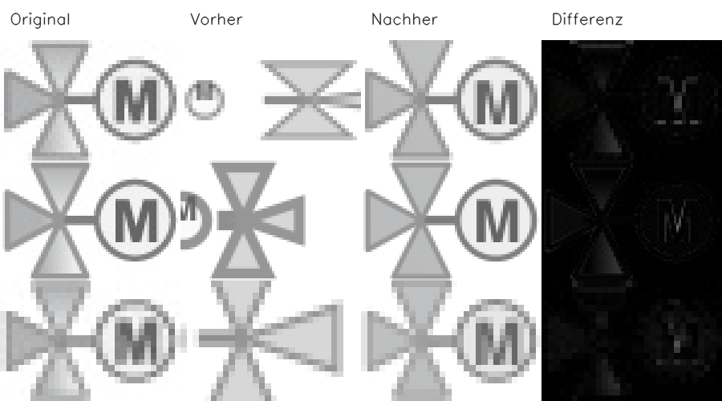

# Arbeitspaket – Dreiwegeventil mit angeschlossener M-Scheibe (2026-10-18)

Branch: `codex/ac0232-search-review-2026-10-18`, Ausgangsstand `05de58ff1`.
Nach AC0921 war `AC0232_M` das nächste dokumentierte Rotationsziel.
Die Größen M/L/S werden gemeinsam bearbeitet. Die vorgelagerte
[Verfahrensprüfung](conversion_search_review_2026-10-18.md) unterscheidet die
heutige Parametersuche von der noch offenen allgemeinen Struktursuche.

## Ursache und überprüfte Hypothesen

Die alte Beschreibung verweist auf zwei andere Bilder und kombiniert mehrere
Drehungsangaben. Das Raster zeigt drei Dreiecke mit gemeinsamer Spitze, links,
oben und unten; ein waagerechter Anschluss führt rechts zu einer hellen
Kreisscheibe mit einem aufrechten M. Beide Kataloge beschreiben dieses Motiv
jetzt eigenständig. Quellbilder und ihre Hashes bleiben unverändert.

1. **Nur eine eigenständige Beschreibung:** Der tatsächliche CLI-Versuch
   wählt einen frühen „Kreis + Buchstabe“-Pfad und verliert die Ventildreiecke.
   Die zusätzlichen Non-Composite-Registrierer werden dabei nicht erreicht.
   Der Versuch besteht 0/3 reguläre Abnahmen und zählt nicht als Verbesserung.
2. **Die vollständige Szene aus gemessenen Grundformen zusammensetzen:** Ein
   gemeinsamer Rasterfit für drei Dreiecke, Anschluss, Kreis und Text erhält
   alle Objekte und verfeinert ihre Parameter gemeinsam. Er wird an beide
   Runtime-Einstiege angeschlossen. Alle drei Größen bestehen die Gates.

Der neue Fit bestimmt die Kreisgeometrie aus dem freien rechten Kreisbogen,
die Dreiecksbasen und gemeinsame Spitze aus beobachteten Geraden, die
Beschriftung aus dem Innenkontrast sowie die Farbwerte aus den sichtbaren
Flächen. Größen, Lage, Strichbreiten und Farben werden gegen gerenderte
Kandidaten registriert. Die Ausgabe enthält native Dreieckspfade, Linie,
Kreis, Text und einen nativen linearen Verlauf. Es werden weder
Rasterkonturen exportiert noch Referenz-SVGs oder Katalogkoordinaten geladen.

Eine weitere technische Ursache war die Renderunterstützung: Der installierte
MuPDF rendert native SVG-Verläufe schwarz. Der bestehende Adapter konnte bei
geschlossenen Pfaden nur achsenparallele Verläufe ersetzen. Er berechnet nun
auch die Farbprojektion auf diagonale Verlaufsachsen, einschließlich Umkehrung
und vorhandener Translation/Skalierung. Nur sein privates Renderdokument
erhält die bereits verwendete Masken-/Farbebene; das gespeicherte SVG behält
native Geometrie und Verlauf. Vier unabhängige analytische Pixelprüfungen
sichern die diagonale Projektion.

Lokale Prüfungen verlangen die beschriebene Anschlusslinie, die vollständige
Flügelsilhouette und den beobachteten Buchstaben. Ein fehlender R-Schenkel
durfte bei einer zu großzügigen Überlappungsprüfung zunächst als P passieren.
Eine größenabhängige Mindestüberlappung und beidseitige Konturabstände weisen
diese Gegenprobe nun ab. Fehlende Flügel, Beschriftung oder Anschlüsse,
zusätzliche Objekte und widersprüchliche Anschlussrichtungen werden ebenfalls
abgewiesen. Das ist ein weiterer unterstützter Szenentyp; allgemeine OCR,
beliebige Ventilrichtungen und automatische neue Topologien sind nicht belegt.

## Gespeicherte echte CLI-Ausgaben

Der Vorlauf wurde vor den Runtime-Änderungen unter neutralen Namen und mit
den alten Beschreibungen eingefroren. Der finale Lauf reproduziert seine
SVGs bytegleich. Der zweite Kontext verwendet Originalnamen und vollständige
alte bzw. korrigierte Kataloge. Die finalen Ausgaben sind zwischen beiden
Namenskontexten bytegleich. Alle sechs Vergleiche verwenden `semantic-only`;
der Zugriffswächter meldet keine verbotenen Referenz-SVG-Lesezugriffe.

| Quelle | Mean-Delta² vorher | Mean-Delta² nachher |
|---|---:|---:|
| AC0232_M | 8982.501953 | 419.309631 |
| AC0232_L | 8444.272461 | 282.161865 |
| AC0232_S | 5625.939941 | 324.581665 |

Alle Größen bestehen beide unveränderten regulären Gates ohne
Pflichtmetrikregression sowie die strengeren Plan-B-Pixelgates. Die
Fehlerreduktion beträgt 94,2–96,7 %; dies ist kein Prozentwert der
wahrgenommenen Bildqualität. Ein einzelner vollständiger Fit benötigt im
gemessenen CLI-Lauf ungefähr sechs Sekunden. Die bisherige Batchlogik kann
denselben Fit aufgrund ihrer Restfehler-Heuristik mehrfach aufrufen; die
Gesamtzeit enthält daher zusätzliche Wiederholungen.



Die unabhängige Vorlage verändert Zeichenfläche, Position, Proportionen,
Farbpalette und Buchstabe (R). Ihre Beschreibung nennt den tatsächlich grünen
Farbverlauf. Original und 16 Zufallsvarianten bestehen über die echte CLI mit
Seed `20261018` **17/17 Fälle**; der gespeicherte Nachweis liegt unter `holdout/`.
Zusätzliche algorithmische Tests prüfen R/P, verschiedene Größen,
umgestellte Richtungswörter, Synonyme und die genannten Negativfälle.

## Bestand und weitere Aufgaben

Die Erfolgsübersicht enthält **377 Paare**. Alle **374 bisherigen Datensätze**,
Originale und Bestresultate bleiben anhand ihrer Hashes unverändert. Der alte
und neue Renderer liefern für alle 374 bisherigen archivierten SVGs exakt
dieselben Pixel. Alle **374 bisherigen Archivbilder** wurden zusätzlich aus
geschützten Kopien mit der tatsächlichen CLI neu konvertiert: **374/374**
bestehen die unveränderte absolute Archiv-Pixelgrenze. Die 371 Ausgaben mit
bereits vorhandenem CLI-Vorlauf sind dazu pixelgleich. Alle tatsächlichen
Ausgaben, Hashes und Workerlogs bleiben erhalten und werden vom Verifikator
erneut gerendert. Die absolute Archivgrenze ist kein Ersatz für die strengeren
Paketgates.

Die 23 bereits dokumentierten Abweichungen vom gespeicherten Bestresultat
bleiben bestehen: 22 historische Kompatibilitätsfälle und der seedabhängige
Lux-S-Fall. Der Vergleich mit den früheren echten CLI-Ausgaben weist für diese
Fälle keine neue Änderung nach; sie werden nicht als neue Paketfehler gezählt.

Der erneuerte Review umfasst weiterhin 1.000 Datensätze, 993 renderbare Paare
und 48 bestandene Bestenlisteneinträge. Alle bisherigen Ausschlüsse bleiben
erhalten; ausschließlich AC0232 L/M/S werden ergänzt. Danach liefert die
bisherige gefilterte Rotation **keinen weiteren Kandidaten**. Die davon
getrennte Grenzfall-Dreiergruppe kann weiterhin bereits abgenommene Bilder
enthalten. Sie ist keine neue Aufgabenrotation.

Als nächstes Architekturpaket ist **SEARCH-DEADLINE-01** dokumentiert:
ein gemeinsames Budget von höchstens 60 Sekunden je Bild einschließlich
plattformübergreifendem Abbruch und geprüftem bestem Zwischenstand.
GENERAL-SCENE-01 und die übrigen offenen Aufgaben bleiben erhalten.

## Reproduktion

Das vollständige Defaultprofil sammelt **3.448 Testknoten** frisch und prüft
jeden exakt einmal: **3.418 bestanden, 30 regulär übersprungen, null Fehler**.
Die beiden zusätzlichen AC08-/AC0100-Smokes bestehen mit festem Suchseed und
explizit direktem Renderer ebenfalls. Ihr Lauf benötigt 9,41 Sekunden. Ein
separater Lauf mit dem unter Pytest voreingestellten einzelnen Kindprozess je
Renderaufruf wurde wegen des hohen Startaufwands abgebrochen. Dieser Versuch
erhält kein Qualitätsurteil; sein Status bleibt in `isolated_smoke_attempt.json`
erhalten. Die isolierte Renderinfrastruktur bleibt durch ihre vorhandenen
Tests im Defaultprofil abgedeckt.

Nachweise: `artifacts/evaluation/motor_valve_recheck_v1/`.

```powershell
.venv/Scripts/python.exe artifacts/evaluation/motor_valve_recheck_v1/verify_evidence.py
.venv/Scripts/python.exe artifacts/evaluation/motor_valve_recheck_v1/run_evidence.py --output-dir .tmp/ac0232-replay
.venv/Scripts/python.exe -m tools.run_plan_b_variations --svg artifacts/evaluation/motor_valve_recheck_v1/independent.svg --description-file artifacts/evaluation/motor_valve_recheck_v1/independent_description.txt --seed 20261018 --output-dir .tmp/ac0232-independent-replay --keep-debug-artifacts
.venv/Scripts/python.exe artifacts/evaluation/motor_valve_recheck_v1/run_checks.py
.venv/Scripts/python.exe -m tools.recheck_satisfactory_archive --max-cases-per-worker 50 --output-dir .tmp/ac0232-archive-replay
.venv/Scripts/python.exe -m compileall -q src tests tools
.venv/Scripts/python.exe -m src.imageCompositeConverter --help
.venv/Scripts/python.exe -m tools.check_no_new_image_id_hardcoding
git -c core.whitespace=cr-at-eol diff --check
```
