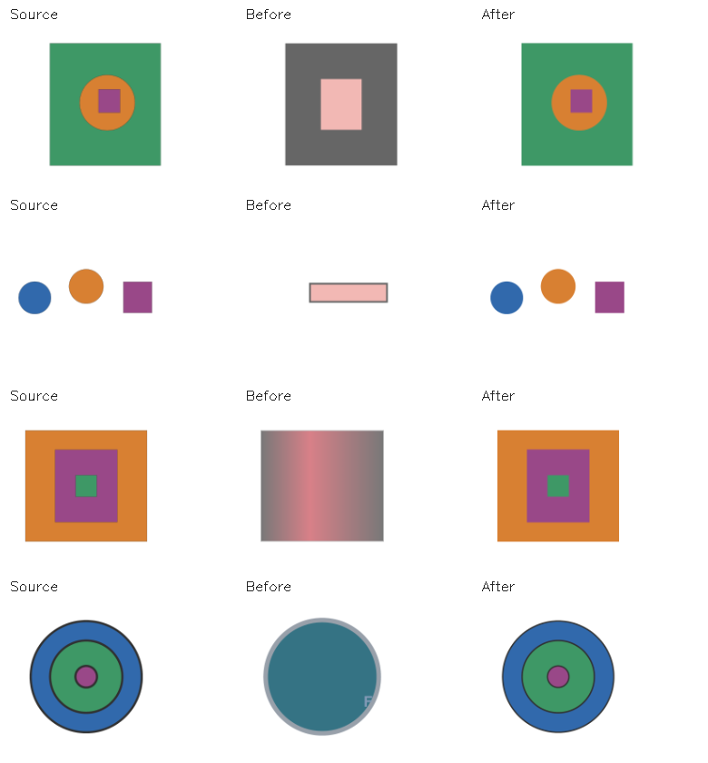

# Gefüllte und verschachtelte Grundformszenen – GENERAL-SCENE-FILLED-02

Stand: 20. Oktober 2026. Branch: `codex/general-scene-01-2026-10-20`.
Elternstand: `e533c4307`.

Das nach NEURAL-ELEMENTS-REAL-02 vorgesehene nächste Szenenpaket ist umgesetzt:
ein bis drei unbeschriftete Kreise/Rechtecke mit einfarbigen Füllungen,
wahlweise eigenen Konturen, getrennt oder vollständig ineinander liegend.
Der allgemeine Converter benötigt dafür ausschließlich Raster und Beschreibung.
Der bisherige Konturweg bleibt vorgeschaltet; sämtliche Qualitätsgrenzen bleiben
unverändert. Das ist der abgeschlossene gefüllte/verschachtelte Teilumfang von
GENERAL-SCENE-01; dessen weitergehende allgemeine Fusion bleibt offen.

## Umsetzung

`imageCompositeConverterLayeredScene.py` erzeugt analytische Formalternativen
aus der gesamten Vordergrundmaske und begrenzten einfarbigen Regionen.
Wiederholte Erkennungen derselben physischen Grenze werden räumlich gruppiert.
Umrisse und gefüllte Flächen können damit dieselbe Instanz beschreiben, statt
als zusätzliche Objekte in der Ausgabe zu erscheinen. Konturpunkte werden
ausschließlich zum Schätzen nativer Kreis-/Rechteckparameter verwendet;
Rastereinbettungen und nachgezeichnete Konturpfade entstehen nicht.

Die begrenzte Beschreibungsgrammatik gleicht Formarten und Anzahlen ab und
prüft Negationen, getrennte Anordnung, horizontale/vertikale Ausrichtung und
vollständige Verschachtelung. Widersprüche oder nicht unterstützte Topologien
liefern keinen Erfolg dieses Registrierers. Ungeklärte zusätzliche analytische
Instanzen dürfen auch bei gutem globalem Pixelwert nicht verworfen werden.
Verschachtelung wird an den nativen Formen geprüft, einschließlich der Ecken
eines Rechtecks innerhalb eines Kreises. Eltern werden vor Kindern gezeichnet.

Kreise werden über unabhängige Mittelpunkte und Durchmesser verfeinert,
Rechtecke über ihre vier unabhängigen Seiten. Dadurch kann ein kleiner Randfehler
korrigiert werden, ohne zunächst eine andere bereits passende Kante zu verschieben.
Die sichtbare Randzone liefert die Elternfarbe auch bei großen Innenobjekten.

Vollständige Szenenalternativen werden innerhalb des bestehenden überwachten
Bildbudgets gemeinsam an das Raster angepasst. Jede Objektregion erhält
dasselbe Gewicht. Das Suchziel verwendet wie die Produktions-CLI den mittleren
absoluten Kanalfehler (MAE). Die erste Entwicklungsfassung verwendete einen
quadratischen Ersatzfehler; dieser konnte sich verbessern, während der
verbindliche MAE schlechter wurde. Ein Entwicklungsfall fiel deshalb durch
die lokale Kantenprüfung. Die endgültige Fassung verwendet MAE und besitzt
dafür eine Regression mit aktivierter Bildaufsicht und echter CLI-Fehlerfunktion.
Keine Qualitätsgrenze wurde dafür abgesenkt.

Jede Objektregion und das vollständige Bild müssen die bestehenden Grenzen
für MSE, Vordergrundfehler, Vordergrund-IoU und Kantenübereinstimmung erfüllen.
Eine kleine Innenform kann deshalb nicht durch eine gut passende große
Außenform verdeckt werden. Der neue Weg ist über `fit_primitive_scene` direkt
an die reguläre `semantic-only`-CLI angeschlossen. Das optionale CNN wurde
nicht verändert oder als Standard aktiviert.

## Unabhängiger Nachweis

`tools.evaluate_layered_scene` erzeugt Referenzen unabhängig vom Produktionsfit.
Die Konvertierungsworker dürfen Referenz-SVGs nicht lesen. Gespeicherte Ausgaben
werden erneut gerendert und mit unveränderten globalen Pixel-/Komplexitätsgrenzen
geprüft. Hinzu kommen Objektzahl, Formart, analytische Außenboxen mit höchstens
2,5 Pixeln Abweichung, Elternreihenfolge und eine eigene Rasterprüfung jeder
Referenzregion. Der Prüfer verwendet keine erkannten Produktionskandidaten.
Das native SVG-Objektinventar ist bewusst auf diesen Ausgabevertrag begrenzt;
es ist kein allgemeiner semantischer Prüfer beliebiger SVG-Pfade.

| Prüfgruppe | Eingefrorener Elternstand | Endgültiger Stand |
| --- | ---: | ---: |
| 18 vor Implementierung eingefrorene Entwicklungsszenen | 0/18 | 18/18 |
| 18 neue Szenen nach endgültigem geometrischem Code-Freeze | 0/18 | 18/18 |
| Neue verschachtelte Plan-B-Vorlage mit 16 Varianten | – | 17/17 |
| Umbenannte finale Prüfszenen | – | 18/18, SVGs bytegleich |

Der mittlere normalisierte MSE sinkt in der Entwicklungsgruppe von
0,02327932 auf 0,00042728 und im neuen Prüfsatz von 0,02367234 auf
0,00065772. Erfolg verlangt zusätzlich sämtliche Objekt-/Regionsprüfungen.



Beide Vergleichsarme laufen durch die echte isolierte CLI mit Suchseed 17,
64 angeforderten Iterationen und fünf Sekunden pro Bild ohne Verlängerung.
Die Prozessaußengrenze des Prüfwerkzeugs beträgt 30 Sekunden. Der Verifikator
verlangt zusätzlich den beobachteten isolierten Fünfsekundenvertrag in den
Runtime-Berichten; allein die Kommandozeile ist kein Budgetnachweis.
Laufzeiten unter paralleler lokaler Testlast erlauben keine Beschleunigungsquote.

Entwicklung: Generatorseed 20261020. Der endgültige neue Prüfsatz verwendet
197323, gedrehte Anordnungen, größere konzentrische Innenobjekte und
umformulierte Beschreibungen. Die abschließende konzentrische Plan-B-Vorlage
verwendet Seed 77426; Geometrie, Skalierung, Lage und Formulierung variieren
zusammen. Beide Sätze wurden nach dem letzten geometrischen Code-Freeze erzeugt.

Die zuvor untersuchten Sätze 261020, 731029, 197320, 197321 und 197322 sind
Entwicklungsdaten. Der erste breitere konzentrische Satz mit Seed 197320
bestand zunächst 17/18. Seine Fehlstelle wurde zur Regression: Kreisradius
und Rechteckseiten müssen unabhängig von der jeweiligen Lage verfeinert werden.
Zusätzlich müssen Füllungs-/Konturalternativen derselben Instanz erhalten
bleiben. Bei einem großen Innenobjekt bestimmt nun die sichtbare Randzone
statt eines vom Kind dominierten Innenmedians die Elternfarbe. Ein separater
realer CLI-Fall mit 75-Prozent-Innenradius wechselt damit von Ablehnung zu
bestandenem strengem Gate. Qualitätsgrenzen wurden nicht angepasst.

Drei spätere Entwicklungsversuche mit Seed 197322 wurden zeitgleich unterbrochen:
bei nominal fünf Sekunden vergingen rund 51 bis 53 Sekunden, ohne einen
verwendbaren Runtime-Abschlussdatensatz. Die Auswertung lehnt diese fehlenden
Ausgaben und Nachweise weiterhin strikt ab. Sie zählen nicht als Erfolge und
bleiben in `checks.json` separat dokumentiert. Sie werden nicht nachträglich
durch einzelne erfolgreiche Messzellen ersetzt. Die endgültige Matrix ist
ein vollständig neuer Lauf mit dem endgültigen Code und den neuen Prüfsätzen;
die Unterbrechungen begründen keine Aussage über eine lückenlos eingehaltene
Wallclock-Grenze bei Umgebungsunterbrechungen.

Die abschließende konservative Sprachprüfung sperrt positive Schriftanforderungen
und doppelte Textnegationen; „unbeschriftet“ wird als ausdrückliche negative
Textbedingung verstanden. Alle 71 erfolgreichen CLI-Fälle der endgültigen Matrix
wurden mit sämtlichen endgültigen Korrekturen ausgeführt und erneut unabhängig
verifiziert. Kein Geometrieparameter oder Qualitätslimit wurde anhand des
endgültigen Prüfsatzes angepasst.

Absichtlich gelöschte, verschobene oder falsch einsortierte Innenobjekte und
zusätzliche verdeckte SVG-Objekte werden abgelehnt. Ein gesonderter Kontrollfall
entfernt einen kleinen gefüllten Innenkreis: Das globale Pixelgate besteht
weiterhin, die lokale Referenzprüfung lehnt ihn ab. Tests verändern außerdem
gesicherte Raster, SVG-Bytes, Fallzahl und Budgetnachweise und verlangen eine
Ablehnung durch den Verifikator.

Der erste Elternlauf aus einer Quellkopie ohne aktivierte Abhängigkeitssuche
lieferte lediglich Raster-Fallbacks und wurde verworfen. Der gültige Vergleich
aktiviert wie die vorherige Szenenabnahme ein leeres lokales
`.venv/Lib/site-packages`-Verzeichnis in der Elternkopie; beide Arme importieren
dieselben Binärbibliotheken aus der tatsächlichen Python-Umgebung.

Die kompakten Nachweise liegen unter
`artifacts/evaluation/layered_scene_v1/`. Vollständige CLI-Protokolle, Berichte
und generierte Ausgaben bleiben unter `.tmp/general-scene-*`; CI lädt ihren
eigenen vollständigen Smoke-Lauf als Artefakt hoch. Die neuen synthetischen
Szenen werden nicht in die abgenommene Katalogsammlung aufgenommen.

## Bestandsprüfung

Alle **377 Archivpaare** sind einschließlich Index hashgleich. Aus geschützten
Kopien erneut konvertiert bestehen **377/377** die vorhandene absolute
Archiv-Pixelgrenze. Keine der 377 Archivbeschreibungen aktiviert den neuen
gefüllten/verschachtelten Registrierer. Die synthetischen Szenen erfüllen
zusätzliche strengere Objekt-/Regionsgrenzen; die Archivabnahme wird dadurch
nicht rückwirkend umdefiniert.

Ein älterer Windows-Fehler beim Schreiben von `batch_failure_summary.csv`
unterbrach den dritten großen Teilbatch mit `OSError: Invalid argument`.
Die ersten 120 abgeschlossenen Fälle bleiben gültig; die übrigen 257 wurden
in kleineren vollständigen Familien und einer gemeinsamen 48-Fälle-Gruppe
für den Kompatibilitätsmodus erneut erfolgreich geprüft. Ein abgebrochener
Teilbatch zählt nicht als abgeschlossene Qualitätsprüfung.

Das absolute Archivgate bedeutet weiterhin nicht Gleichheit mit jedem
gespeicherten Bestresultat: **41** Neukonvertierungen haben einen höheren
`mean_delta2` als der archivierte Stand, davon 22 im historischen
Kompatibilitätsmodus und 19 in `semantic-only`. Die 22 Kompatibilitätsfälle
sind bereits im vorherigen Szenenbericht dokumentiert. Die 19 semantischen
Fälle wurden zusätzlich mit dem unveränderten Elterncode konvertiert:
18 liefern bytegleiche SVGs. `AC0840_M` unterscheidet sich zwischen den
Batchläufen (713,849976 beim Elternlauf gegenüber 1235,542480 beim neuen
Archivlauf), obwohl keiner den neuen Szenenweg verwendet und beide das
Archivgate bestehen. Drei weitere gepaarte Einzelkontrollen mit neutralem
Namen, identischen Rasterpixeln und Suchseed 0 liefern in beiden Ständen
dieselben SVG-Bytes. Diese Kontrollen ersetzen keinen Nachweis identischer
historischer Bestwerte oder vollständiger Wiederholbarkeit aller Batchläufe.
Der Scheduler und die bestehende Kurztextsuche wurden hier nicht geändert.
Die gespeicherten besseren SVGs wurden nicht überschrieben.

Lokale Archivnachweise: `.tmp/general-scene-archive-resume/report.json`,
`.tmp/general-scene-archive-parent-comparison.json` und
`.tmp/general-scene-scheduler-control/report.json`.

## Reproduktion

```powershell
.venv/Scripts/python.exe -m tools.evaluate_layered_scene --prepare .tmp/layered-inputs --seed 197323 --count 18 --rotate --paraphrase --wide-nesting
.venv/Scripts/python.exe -m tools.evaluate_layered_scene --inputs .tmp/layered-inputs --output .tmp/layered-results --require-all
.venv/Scripts/python.exe -m tools.evaluate_layered_scene --inputs .tmp/layered-inputs --output .tmp/layered-results --verify-only --require-all
.venv/Scripts/python.exe -m tools.evaluate_layered_scene --prepare .tmp/layered-plan-b-inputs --seed 77426 --variations --wide-nesting
.venv/Scripts/python.exe -m tools.evaluate_layered_scene --inputs .tmp/layered-plan-b-inputs --output .tmp/layered-plan-b --require-all
.venv/Scripts/python.exe -m pytest -q tests/test_layered_scene_runtime.py tests/test_primitive_scene_runtime.py tests/test_neural_elements.py tests/test_real_neural_elements.py tests/detailtests/test_plan_b_variations.py
```

`--rename` prüft dieselben eingefrorenen Raster unter anonymen Dateinamen.
`python -m tools.summarize_layered_scene_evaluation --verify-only` prüft die
versionierten kompakten Raster-/SVG-Paare auch ohne vorherigen lokalen CLI-Lauf.
Jeder Lauf verlangt ein frisches Ausgabeverzeichnis. `--verify-only` prüft
einen vorhandenen eigenen Lauf erneut; ein frischer Checkout muss zuerst
konvertieren. Der CI-Job `layered-primitive-scenes` erzeugt sechs neue gedrehte
Fälle, konvertiert sie durch überwachte Worker und verifiziert die gespeicherten
Ausgaben erneut. Er ersetzt keine repräsentative Katalogmessung.

## Abschlussprüfungen

Die normale Standardsuite besteht mit **3.596 bestandenen und 30 regulär
übersprungenen Tests**. Sie wurde vor den letzten lokal begrenzten
Szenenkorrekturen gesammelt. Die abschließende Regression der betroffenen
Szenen-, Netz- und Plan-B-Module besteht mit **153 Tests** auf dem endgültigen
Code. Die XML-Berichte decken gemeinsam alle **3.644 aktuell gesammelten
Test-IDs** ab; keine fehlt. Die drei ausdrücklich aus dem Standardprofil
herausgenommenen schweren Module wurden nicht zusätzlich gestartet.

Der neue CI-Smoke ist lokal mit sechs CLI-Ausgaben ausgeführt und erneut
verifiziert; ein entfernter CI-Lauf wurde nicht gestartet. Syntaxprüfung,
CLI-Help, Bild-ID-Hardcoding-Prüfung und Whitespace-Prüfung bestehen ebenfalls.
Die vollständigen Protokolle und XML-Prüfsummen sind in `checks.json` angegeben.
Die lange Laufdauer der Gesamtsuite einschließlich Unterbrechungen und
paralleler Entwicklungsarbeit ist keine Konvertierungs-Laufzeitmessung.

## Geltungsbereich und Folgearbeit

Unterstützt sind weißer Hintergrund, achsparallele Rechtecke, Kreise,
einfarbige Regionen und klar sichtbare, voneinander unterscheidbare Grenzen.
Sehr kleine oder kontrastarme Merkmale, gleiche verdeckende Füllfarben,
partielle Überlagerung, Berührung, Text, Verläufe und beliebige Formrelationen
haben keinen allgemeinen Rekonstruktionsnachweis. Die konservative deutsche
Grammatik ist kein freies Sprachverständnis. 36 synthetische Vergleichsszenen
und eine erweiterte Vorlage begründen keine allgemeine Katalog-Erfolgsquote.

GENERAL-SCENE-01 bleibt für die übergreifende Fusion unterschiedlicher
Detektorfamilien, partielle Überdeckungen und den Anschluss weiterer Topologien
offen. Der historische allgemeine Perception-IR-Merge wird in diesem Paket
nicht pauschal umgestellt. NEURAL-ELEMENTS-01, IDO-19/IDO-21 und
SEARCH-DEADLINE-COMPAT behalten ihren bisherigen offenen Status.
