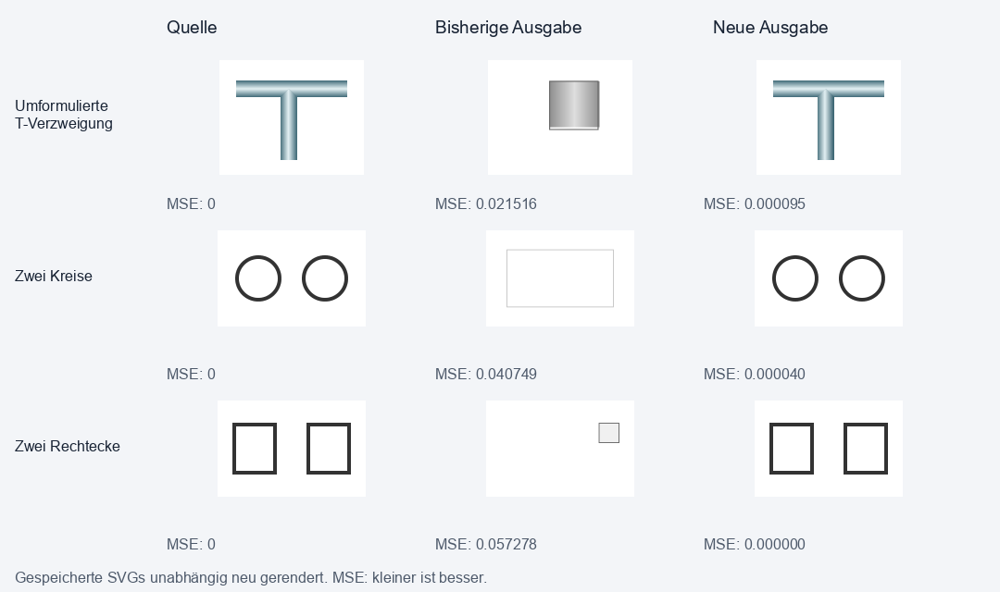

# Konvertierungsverbesserung und Qualitätsmessung (2026-10-17)

Für ein bis drei getrennte, unbeschriftete Kreis- und Rechteckkonturen gibt es
jetzt einen gemeinsamen Szenenweg. Bei der T-Verzweigung schalten geprüfte
sinngleiche Formulierungen denselben Registrierer frei. Auf den 24 gezielten
Szenen sinkt der mittlere normalisierte quadratische Pixelfehler um mehr als
99,7 Prozent. Die sechs Diagnosefälle der vorherigen Aufgabe bestehen jetzt
alle das unveränderte strenge Gate; vorher bestand einer.

## Gemessene Verbesserung

| Eingefrorene Gruppe | Vorher bestanden | Nachher bestanden | Mittlerer MSE vorher | Mittlerer MSE nachher | Fehlerreduktion |
|---|---:|---:|---:|---:|---:|
| 12 vor Implementierung erzeugte Szenen | 0/12 | 12/12 | 0,01019628 | 0,00002634 | 99,74 % |
| 12 nach Code-Freeze erzeugte senkrechte Anordnungen | 0/12 | 12/12 | 0,01219921 | 0,00002426 | 99,80 % |
| Sechs bisherige Diagnosefälle | 1/6 | 6/6 | 0,02415503 | 0,00004177 | 99,83 % |

Alle 24 Szenen bestehen zusätzlich eine unabhängige Prüfung der Objektzahl
und der äusseren Objektpositionen. Deren Referenz sind die analytischen
Geometrien des Testgenerators, nicht die vom Konverter geschätzten Parameter.
Die T-Verzweigung mit unveränderter Beschreibung bleibt exakt bei ihrem
bisherigen Fehlerwert. In den drei Gruppen verschlechtert sich kein MSE.
Ein zusätzlicher Rename-Lauf liefert bei allen zwölf Holdouts bytegleiche SVGs.



Bei der umformulierten T-Verzweigung sinkt der MSE von 0,02151617 auf
0,00009521, bei zwei Kreisen von 0,04074915 auf 0,00004014 und bei zwei
Rechtecken von 0,05727819 auf null. Null bedeutet hier Pixelgleichheit unter
dem verwendeten Renderer und in der geprüften Auflösung.

## Nachgewiesene falsche Qualitätsfreigabe

Ein gesonderter Gegenversuch entfernt absichtlich einen kleinen Kreis neben
einem grossen Rechteck. Das ist eine bewusst beschädigte Ausgabe zur Prüfung
der Bewertungsmethode, keine Behauptung über die Häufigkeit solcher Fehler im
Katalog.

| Messgrösse nach Entfernen des Kreises | Wert | Bisherige Grenze | Pixelprüfung |
|---|---:|---:|---|
| Normalisierter MSE | 0,00090712 | höchstens 0,01 | bestanden |
| Vordergrund-MSE | 0,01853499 | höchstens 0,04 | bestanden |
| Konturübereinstimmung | 0,966527 | mindestens 0,72 | bestanden |
| Vordergrund-IoU | 0,959488 | mindestens 0,85 | bestanden |
| Objektzahl | 1 statt 2 | vollständige Szene erforderlich | **verfehlt** |

Das kleine Objekt geht zu **100 Prozent** verloren, die Objektzahl sinkt um
50 Prozent. Trotzdem bestehen sämtliche bisherigen Pixelgrenzen. Der MSE
steigt gegenüber der identischen Vorlage von null um 0,00090712; der
Vordergrund-IoU sinkt um 4,05 Prozentpunkte. Eine einzelne globale
Qualitätszahl kann diese inhaltliche Verschlechterung verdecken.

Eine ergänzende Serie variiert den Radius des vollständig entfernten Kreises
von 2 bis 24 Pixeln. Sieben der 13 absichtlich beschädigten Ausgaben bestehen
weiterhin das globale Pixelgate. In dieser Anordnung liegt der grösste
übersehene Kreis bei Radius 10 Pixeln, also 22 Pixeln Aussendurchmesser
einschliesslich Kontur. Dann fehlen **8,21 Prozent des Vordergrunds**;
MSE 0,00179347, Vordergrund-MSE 0,03506017, Konturübereinstimmung 0,938976
und IoU 0,917899 bestehen dennoch. Ab dem geprüften Radius 12 verfehlt der
Vordergrund-MSE die Grenze. Die gesonderte Objektbereichsprüfung erkennt alle
13 vollständigen Löschungen.

Sieben weitere Varianten verschieben den kleinen Kreis um 1 bis 20 Pixel.
Alle bestehen das globale Gate. Bei 20 Pixeln Abweichung beträgt der MSE
0,00181425 und der IoU 0,922131; die unabhängige Positionsprüfung mit
2,5 Pixeln Toleranz lehnt die Verschiebung ab. Kleine Verschiebungen innerhalb
dieser Toleranz werden dadurch nicht pauschal als inhaltlicher Fehler erklärt.
Die vollständigen 20 kontrollierten Änderungen stehen in
[`quality_damage/report.json`](../artifacts/evaluation/primitive_scene_2026-10-17/quality_damage/report.json).
Sie wurden ausdrücklich ohne Konverter erzeugt, um die Bewertungsgrenzen
isoliert zu untersuchen. Sieben von 13 ist keine Katalog-Fehlerrate.

Der neue Szenenweg gleicht die Anzahl je Formart mit der Beschreibung ab und
prüft jedes Objekt in seinem eigenen Bildbereich. Dadurch kann ein grosses,
gut passendes Objekt den Fehler eines kleinen Objekts bei der Freigabe dieses
Weges nicht verdecken. Die unabhängige Abnahme prüft die vollständige Ausgabe
nochmals gegen die Referenzobjekte. Die katalogweiten bisherigen Gates wurden
nicht verändert; dort ist eine allgemeine semantische Objektprüfung weiterhin
eine offene Erweiterung.

## Umsetzung und Grenzen

`imageCompositeConverterPrimitiveScene.py` behandelt jede getrennte
Vordergrundkomponente als eigene Instanz. Innere und äussere Konturen liefern
alternative analytische Kreis- und Rechteckmodelle. Die Beschreibung begrenzt
Anzahl und Formarten und unterstützt unter anderem „zwei voneinander getrennte
Kreise“, „nebeneinander“ und „untereinander“. Widersprüche, zusätzliche
Beschriftung, Verläufe, gefüllte Flächen und Überlagerungen werden von diesem
Weg abgelehnt. Die bisherigen Wege bleiben dann zuständig.

Die ausgewählte vollständige Szene wird gemeinsam an das Raster angepasst.
Alle Objekte erhalten dasselbe Gewicht im Suchziel. Ausgegeben werden native
SVG-Kreise und -Rechtecke; Konturpolygonzüge und Rastereinbettungen werden
nicht übernommen. Die Freigabe verlangt für jedes Objekt und für das Gesamtbild
MSE, Vordergrundfehler, IoU und Konturübereinstimmung innerhalb der unveränderten
strengen Plan-B-Grenzen. Die Implementierung greift nur auf Raster und
Beschreibung zu.

Für die T-Verzweigung werden „heller Mitte“, „heller zentraler Zone“, „hellem
Zentrum“ und „aufgehellter Mitte“ gleich behandelt. Die weiteren strukturellen
Voraussetzungen und der geometrische Rasterfit bleiben erhalten. Dies ist eine
begrenzte sprachliche Erweiterung, kein allgemeines Sprachverständnis.

Das Paket deckt dunkle, geschlossene Konturen auf weissem Hintergrund,
achsparallele Rechtecke und getrennte Kreise ab. Es vervollständigt weder den
allgemeinen Fusionshelfer noch die Topologiesuche. Dessen bisherige
Isolationstests verlieren weiterhin Mehrfachinstanzen; der neue Szenenweg
umgeht diesen Informationsverlust für seinen unterstützten Bereich.
GENERAL-SCENE-01 bleibt deshalb als umfassenderes Arbeitspaket offen.

## Bestandsprüfung und tatsächlich schwächere Neukonvertierungen

Alle 343 Archivbilder wurden aus geschützten Kopien erneut konvertiert. Davon
laufen 295 im Standardmodus `semantic-only` und 48 im ausdrücklichen
Kompatibilitätsmodus `standard`. Alle 343 bestehen die bisherige absolute
Archiv-Pixelgrenze von 0,04594568. Das bedeutet **nicht**, dass jede neue
Ausgabe mindestens so gut wie das gespeicherte Bestresultat ist:

| Ausführungsmodus | Gleich gut wie gespeichertes Bestresultat | Besser | Schlechter |
|---|---:|---:|---:|
| `semantic-only` | 267 | 28 | 0 |
| `standard` (Kompatibilität) | 18 | 8 | 22 |

Damit erhalten 321 von 343 Läufen mindestens den gespeicherten Pixelstand.
Bei 22 Kompatibilitätsfällen verschleiert ein blosses „Gate bestanden“ eine
Verschlechterung gegenüber dem gespeicherten Bestresultat. Die neue Auswertung
weist `pixel_gate_passed` und `preserves_saved_best` deshalb getrennt aus und
markiert alle 22 historischen Regressionen ausdrücklich.

Das stärkste relative Beispiel ist `AC0811_L`: `mean_delta2` steigt von
541,83197 auf 3245,50928, also um 498,99 Prozent bzw. auf das 5,99-Fache.
Der RGB-RMSE steigt damit auf das 2,45-Fache. Die neue Ausgabe liegt mit
normalisiertem Fehler 0,01663724 weiterhin unter der alten Archivgrenze.
Der grösste absolute Anstieg in der Gruppe beträgt 3005,00146 `mean_delta2`
bei `AC0811_M`. Diese Werte beschreiben Fehlergrössen, keine prozentuale
„Bildqualität“.

Um die Ursache nicht den neuen Änderungen zuzuschreiben, wurden alle 48
Kompatibilitätsfälle zusätzlich mit dem unveränderten Code aus Commit
`daaa5c0a0` ausgeführt. Eingaben, Beschreibungstabelle, SVG-/Report-Ressourcen,
Iterationsbudget, Zufallsseed und Binärbibliotheken stimmen überein. **Alle 48
alten und neuen Ausgaben sind nach dem Rendern pixelgleich**, auch die 22
gegenüber historischen Bestresultaten verschlechterten Fälle. Diese Schwäche
besteht somit bereits beim erneuten Lauf des bisherigen Verfahrens. Die 28
Verbesserungen gegenüber Archivbildern werden ebenso wenig den neuen
Szenenänderungen zugeschrieben.

Diese Gegenprüfung ergänzt die Beschreibungspfad-Prüfung: Keine der 343
Archivbeschreibungen aktiviert den neuen Szenenweg, und die Voraussetzungen
für die T-Verzweigung bleiben auf allen 343 Beschreibungen gleich.
Die gespeicherten Bestresultate wurden nicht überschrieben.

Die Archiv-Pixelgrenze ist eine andere, ältere Prüfung als das strenge
Plan-B-Gate der 24 Szenen. „343 unter der Archivgrenze“ darf weder als
„343 ohne historische Regression“ noch als „343 bestehen die strengeren
Objekt- und Konturprüfungen“ interpretiert werden. Ergebnisse und gespeicherte
Neukonvertierungen:
[`archive_recheck/report.json`](../artifacts/evaluation/primitive_scene_2026-10-17/archive_recheck/report.json),
[`compatibility_comparison.json`](../artifacts/evaluation/primitive_scene_2026-10-17/archive_recheck/compatibility_comparison.json).

## Messverfahren und Reproduktion

Die zwölf Entwicklungsfälle wurden vor Änderungen am Produktionscode
eingefroren und mit der echten CLI vermessen. Die zwölf Holdouts wurden nach
dem letzten Produktionscode-Freeze mit anderem Zufallsseed erzeugt und um
90 Grad gedreht. Für deren Vorher-Messung wurde `HEAD` vor dieser Änderung
als reine Quellkopie unter `.tmp/primitive-scene-baseline` ausgepackt. Ein
leeres `.venv/Lib/site-packages`-Verzeichnis dort aktiviert die bestehende
Abhängigkeitssuche; die Worker importieren dieselben bereits geladenen
NumPy-, OpenCV-, Pillow- und PyMuPDF-Bibliotheken aus der lokalen Umgebung.
Die misslungene erste Baseline ohne diese Suchpfadaktivierung wurde verworfen.
Die Seeds 20261017 und 261071 und die Drehung sind in `generation.json`
gespeichert. Eine erneute Generierung reproduziert alle Raster- und
Referenzprüfsummen exakt.

Jeder Fall läuft in einem eigenen Prozess mit `semantic-only`, deterministischer
Reihenfolge und 64 angeforderten Iterationen. Die analytischen Registrierer
verwenden wie die bestehenden Registrierer eine eigene begrenzte Rendersuche;
die Zahl 64 ist daher kein Beleg identischer Renderkosten zwischen Algorithmen.
Der SVG-Zugriffswächter meldet null verbotene Referenzzugriffe. Eingaben,
Referenzen und finale SVGs haben SHA-256-Nachweise. Die unabhängige Auswertung
rendert die gespeicherten SVGs erneut; sie übernimmt keine Erfolgsetiketten des
Konverters. Nebenläufig gemessene Laufzeiten begründen keine Beschleunigungsquote.

```powershell
.venv/Scripts/python.exe -m tools.evaluate_primitive_scene --inputs artifacts/evaluation/primitive_scene_2026-10-17/frozen_inputs --output .tmp/scene-replay
.venv/Scripts/python.exe -m tools.evaluate_primitive_scene --inputs artifacts/evaluation/primitive_scene_2026-10-17/holdout_final_inputs --output .tmp/scene-holdout-replay
.venv/Scripts/python.exe -m tools.summarize_primitive_scene_evaluation artifacts/evaluation/primitive_scene_2026-10-17
.venv/Scripts/python.exe -m pytest -q tests/test_primitive_scene_runtime.py tests/test_gradient_junction_runtime.py --basetemp=.tmp/scene-tests
```

Vollständige Einzelwerte und Grenzen:
[`summary.json`](../artifacts/evaluation/primitive_scene_2026-10-17/summary.json).
Die archivierten erfolgreichen Paare bleiben unverändert; die Diagnosefälle
werden nicht in die Sammlung abgenommener Katalogbilder aufgenommen.
24 gezielte synthetische Szenen erlauben keine Aussage über eine allgemeine
Erfolgsquote oder Fehlbewertungsrate des gesamten Katalogs.

## Abschlussprüfungen

Die vollständige normale Pytest-Sammlung wurde in vier unabhängigen Gruppen
ausgeführt: **3235 bestanden, 30 regulär übersprungen, null Fehler**. Die
abschliessenden Widerspruchsprüfungen und betroffenen Szenentests bestehen
separat mit 31 Tests. Zusammen decken die XML-Berichte alle 3270 aktuell
gesammelten Testfälle ab; keine aktuelle Test-ID fehlt. Die drei ausdrücklich
ausgenommenen schweren Konvertierungsmodule bleiben vom normalen Profil
ausgenommen. Zusätzlich bestehen `compileall`, CLI-Help, die
Bild-ID-Hardcoding-Nullprüfung und `git diff --check`.

25 Dateioperationstests scheiterten zunächst im allgemeinen temporären
Windows-Sandbox-Verzeichnis. Dieselben Fehler wurden auf unverändertem
Baseline-Code reproduziert; mit separaten temporären Verzeichnissen im
Workspace bestehen alle 25 und die vollständige Sammlung. Zwei lange
Archivprozesse scheiterten beim Schreiben von CSV-Berichten. Für die
Endauswertung zählen nur erfolgreich abgeschlossene Prozesse; die restlichen
semantischen Fälle wurden einzeln erneut konvertiert. Die 48 Kompatibilitätsfälle
behalten jeweils ihren gemeinsamen Batch-Kontext.

Zusammenfassung und XML-Nachweise:
[`validation.json`](../artifacts/evaluation/primitive_scene_2026-10-17/validation.json),
[`checks/`](../artifacts/evaluation/primitive_scene_2026-10-17/checks).
