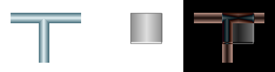
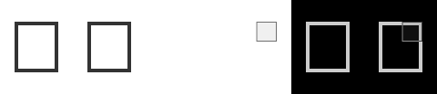

# Warum die allgemeine Rekonstruktion stockt (2026-10-17)

Die wichtigste nachgewiesene Lücke ist die **Auswahl und Zusammensetzung einer
vollständigen Szene aus erkannten Grundformen**. Der Konverter passt viele
bekannte Topologien zuverlässig an. Der allgemeine Weg verliert jedoch schon
bei einfachen neuen Zusammenstellungen Informationen. Mehr lokale
Parameteroptimierung kann eine im Ausgangsmodell fehlende Form nicht ergänzen.

Untersucht wurde Commit `8a81d2c94`. Die Untersuchung liegt auf
`codex/reconstruction-bottleneck-audit-2026-10-17`. Produktionscode und
Qualitätsgrenzen wurden nicht verändert. Zwei Berichtswerkzeuge kennzeichnen
ihre bisherigen Ersatzmesswerte jetzt ausdrücklich als Vertragsbeispiele.

## Echte Gegenproben

Sechs gezielte synthetische Fälle wurden unter neutralen Namen durch die echte
CLI im Modus `semantic-only` mit 64 Iterationen verarbeitet. Gespeicherte SVGs
wurden unabhängig neu gerendert und nach unveränderten Plan-B-Grenzen bewertet.
Der Verweiszugriffs-Wächter meldet bei allen Fällen null verbotene SVG-Zugriffe.
Ein zweiter Lauf reproduziert die Ein- und Ausgabehashes, Metriken und Pfadwahl.
Dies ist eine Ursachenprüfung, kein repräsentativer Katalogbenchmark.

| Fall | Normalisierter quadratischer Pixelfehler | Strenges Gate | Gewählter Weg |
|---|---:|:---:|---|
| T-Verzweigung, bisherige zutreffende Formulierung | 0.00009521 | bestanden | T-Registrierung |
| Dasselbe Raster, sinngleiche Umformulierung | 0.02151617 | verfehlt | Verlauf + Rechteck |
| Ein unbeschrifteter Kreis | 0.02069965 | verfehlt | allgemeiner Panel-Fit |
| Zwei unbeschriftete Kreise nebeneinander | 0.04074915 | verfehlt | allgemeiner Panel-Fit |
| Ein unbeschriftetes Rechteck | 0.00459178 | verfehlt | Rechteck-Geometrie |
| Zwei unbeschriftete Rechtecke nebeneinander | 0.05727819 | verfehlt | eine Rechteck-Geometrie |

Beim einzelnen Rechteck verfehlen nur Vordergrundfehler und Vordergrund-IoU
das strengere Gate; die globale Pixelgrenze wird eingehalten. Die Tabelle
behauptet deshalb keine vollständige reguläre Katalogabnahme oder deren Fehlschlag.
Beim einen und bei den zwei Kreisen entsteht sogar dasselbe Ausgabe-SVG.

Maschinenlesbare Ergebnisse:
[`report.json`](../artifacts/evaluation/reconstruction_bottlenecks_2026-10-17/evidence/report.json).
Die Vergleichsbilder zeigen jeweils links die Quelle, mittig die Konvertierung
und rechts die absolute Pixeldifferenz:





## Befund 1: Beschreibung schaltet fertige Topologien frei

`fit_gradient_junction` verlangt unter anderem die wörtliche Folge
`heller mitte`; siehe
[`imageCompositeConverterGradientJunction.py`](../src/iCCModules/imageCompositeConverterGradientJunction.py).
Die Ersetzung durch `heller zentraler Zone` lässt den passenden Registrierer
ausfallen. Das identische Raster wird dann mit einem falschen Grundmodell
approximiert. Der quadratische Pixel-Fehlerwert steigt um etwa Faktor 226.
Der Optimierer verbessert dieses falsche Rechteckmodell, stellt aber die
fehlende T-Struktur nicht wieder her.

Ein Synonym würde diesen einen Fall retten. Die grundsätzliche Schwäche bleibt:
freie Sprache wird an vielen Stellen über getrennte Wortlisten und reguläre
Ausdrücke direkt auf ganze Symbolmodelle abgebildet. Benötigt wird ein
gemeinsamer Satz von Objekten und Beziehungen, der alternative Formulierungen
gleich behandelt und durch das Raster überprüft wird.

## Befund 2: Erkannte Instanzen werden verworfen

Bei den zwei Rechtecken liefert `detect_perception_candidates` zwei korrekte,
räumlich getrennte Rechteckkandidaten. Die allgemeine Übernahme verwendet nur
den besten Kandidaten, wenn noch kein `RectBorder` vorhanden ist. Der
Beschreibungspfad erzeugt für den Plural ebenfalls nur ein Rechteck.
Die Kreisübernahme verwendet ausdrücklich nur den stärksten Kreis-/Ringkandidaten.
Die IR und der Renderer könnten mehrere Instanzen darstellen; diese Schritte
erzeugen bzw. erhalten sie jedoch nicht zuverlässig.

Zwei zusätzliche Isolationstests übergeben jeweils zwei bereits korrekte,
getrennte Kandidaten ohne Beschreibung. Auch dann entstehen nur ein
`CircleBackground` bzw. ein `RectBorder`. Damit ist ein Informationsverlust
nach der Erkennung belegt, unabhängig von deren Genauigkeit.

Quelle:
[`perception_detection_contract.py`](../tools/perception_detection_contract.py),
Funktionen `merge_circle_ring_candidates_into_geometry_ir` und
`merge_perception_candidates_into_geometry_ir`.

Daneben werden Kontursegmente als zusätzliche Linien und auf unbeschrifteten
Formen als mögliche Buchstaben erkannt. Im Versuch liefert schon ein Ring
17 Glyphenkandidaten trotz „Keine Beschriftung“. Diese sind alternative
Deutungen, keine 17 echten Buchstaben. Die Übernahme fügt dennoch einen
Textkandidaten hinzu. Ein gemeinsamer Szenenabgleich müsste diese Alternativen
und die negative Textbedingung behandeln.

## Befund 3: Der allgemeine Abgleich ist nicht wirksam verbunden

`fuse_description_constraints_with_perception_candidates` existiert und kann
Kandidaten, Beschreibungsbedingungen und Unsicherheit zusammenführen. Die
AST-Inventur findet keinen direkten Aufruf dieser Funktion unter `src/`.
Der Runtime-Weg `build_perception_seeded_geometry_ir` verwendet stattdessen
die oben beschriebene Übernahme. `Reflection` erzeugt Beschreibungsbedingungen,
der untersuchte Non-Composite-Weg verwendet aber keine gemeinsame Fusion daraus.

Die Fusionsfunktion reicht Beziehungen außerdem als Metadaten weiter; das ist
noch kein gemeinsamer geometrischer Löser. Die Funktion lediglich aufzurufen
würde deshalb die Szenenrekonstruktion noch nicht vervollständigen.

## Befund 4: Parameteroptimierung ersetzt keine Struktursuche

Die frühen Topologie-Registrierer im
[`NonCompositeRuntime`](../src/iCCModules/imageCompositeConverterNonCompositeRuntime.py)
liefern bei einem passenden Fit direkt ihr Ergebnis. Der allgemeinere Weg
kommt erst danach. Dort wird der Perception-Vorschlag zunächst gerendert und
bewertet; die ausführliche IR-Registrierung verfeinert den separaten
Beschreibungsvorschlag.

Der vorhandene
[`GeometryIrOptimizer`](../src/iCCModules/imageCompositeConverterGeometryIrOptimizer.py)
kann Lage, Skalierung, Konturstärke und vorhandene Elemente verbessern.
Der Standard-Kandidatenlieferant baut jedoch keine alternative Szene mit
zusätzlichen, entfernten oder ersetzten Objekten auf. Deshalb hilft mehr
Suchbudget nicht, wenn beispielsweise ein zweites Rechteck gar nicht im Modell
vorkommt. Es fehlt eine begrenzte Suche über plausible Szenenzusammenstellungen
und die Zuordnung der noch unerklärten Bildbereiche.

## Befund 5: Ein Teil der bisherigen Generalisierungsnachweise ist nur ein Testgerüst

`tools/build_holdout_ablation_matrix.py` liest keine Testbilder. `_image_terms`
leitet vermeintliche Bildmerkmale aus Beschreibungstermen ab; `_score` berechnet
vorgegebene Ersatzwerte je Modus. `tools/run_end_to_end_holdout_acceptance.py`
übernimmt diese Werte und erzeugt ein Vorschau-SVG selbst. Das ist kein Lauf
des Produktionskonverters. Die Rename-Prüfung testet dort nur den Namenspräfix,
die Unsicherheitsprüfung verwendet die Ersatzwerte.

Diese Werkzeuge sind als Berichtsverträge brauchbar. Ihre grünen Tests belegen
jedoch keine erreichte Ablation, Rename-Invarianz oder kalibrierte Unsicherheit
an unbekannten Bildern. IDO-19 und IDO-21 sind deshalb wieder offen. Künftige
JSON- und Konsolenberichte kennzeichnen sich ausdrücklich mit
`evidence_kind=contract_fixture`, `executes_converter=false` und
`measures_raster_quality=false`. Historische Berichte bleiben erhalten.

Die echten jüngeren CLI-Abnahmen und 343 gespeicherten Archivpaare werden
durch diesen Befund nicht widerlegt. Sie belegen ihre geprüften Familien,
keine allgemeine Fähigkeit zur neuen Szenenzusammensetzung.

## Vorrangiger Verbesserungsschritt: allgemeine Szenenzusammensetzung

Als erstes begrenztes Paket eignet sich ein gemeinsamer Weg für **ein bis drei
getrennte Kreise oder Rechtecke**, einschließlich gemischter Anordnungen.
Verläufe, Überdeckungen und Text gehören noch nicht zu diesem ersten Schritt.

1. **Messung zuerst:** Ein eingefrorener Satz mit neuen Anordnungen und
   Beschreibungssynonymen muss echte Rasterdateien durch die Produktions-CLI
   führen. Qualität und Objektzahl werden aus den gespeicherten SVGs geprüft.
   Eine zusätzliche ungesehene Auswertung wird erst nach dem Code-Freeze erzeugt.
2. **Instanzen erhalten:** Räumlich getrennte Kandidaten übernehmen;
   Mehrfacherkennungen derselben Kontur deduplizieren. Ein pauschales Übernehmen
   aller Detektionen würde Fehlalarme und doppelte Konturen erzeugen.
3. **Gemeinsame Auswahl:** Anzahl, Form, relative Lage und „keine Beschriftung“
   mit den Rasterkandidaten abgleichen. Konkurrierende Deutungen zunächst als
   Alternativen erhalten und nur plausible Szenen rendern.
4. **Vollständige Szene verfeinern:** Alle ausgewählten Instanzen anpassen;
   Farben und Strichstärken lokal aus ihren Bildbereichen bestimmen.
   Unerklärte Restbereiche können begrenzte Ergänzungs-/Ersetzungsvorschläge
   auslösen. Das Raster und eine Komplexitätsgrenze entscheiden über die Annahme.

Die Abnahme muss Objektzahl und Objektposition unabhängig prüfen; eine globale
Pixelmetrik kann kleine fehlende Formen übersehen. Zusätzlich gelten die
unveränderten Qualitätsgrenzen, Rename-Invarianz, eine reine Bild-/Beschreibungs-
Eingabe und Bestandsschutz für die 343 archivierten Fälle. Ablationen vergleichen
den jetzigen Weg und die Szenenauswahl bei gleichem Budget.

Dieses Paket würde eine strukturelle Lücke verkleinern. Es wäre noch kein
Nachweis für beliebige neue Motive. Weitere Detectoren, Kurven und Verläufe
sollten anschließend denselben Szenenweg ergänzen. Der bereits vorgeschlagene
ImageDetector bleibt dafür nützlich; seine Anbindung und Kandidatenauswahl
entscheiden über den tatsächlichen Nutzen.

## Reproduktion der Untersuchung

```powershell
.venv/Scripts/python.exe artifacts/evaluation/reconstruction_bottlenecks_2026-10-17/run_probe.py --output-dir .tmp/bna-replay
.venv/Scripts/python.exe artifacts/evaluation/reconstruction_bottlenecks_2026-10-17/verify_evidence.py
.venv/Scripts/python.exe -m pytest -q tests/test_holdout_ablation_matrix.py tests/test_end_to_end_holdout_acceptance.py
git -c core.whitespace=cr-at-eol diff --check
```

Die sechs gezielten Proben dürfen als Diagnose nicht in die Erfolgsübersicht
aufgenommen werden. Die Architekturverbesserung selbst ist noch nicht umgesetzt.
